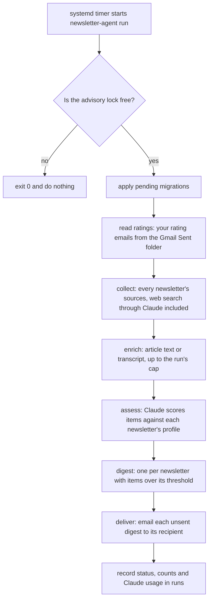
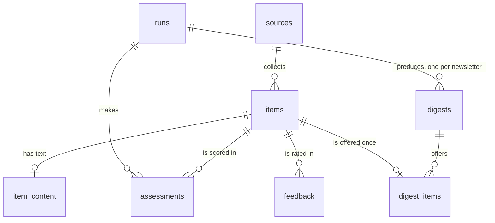
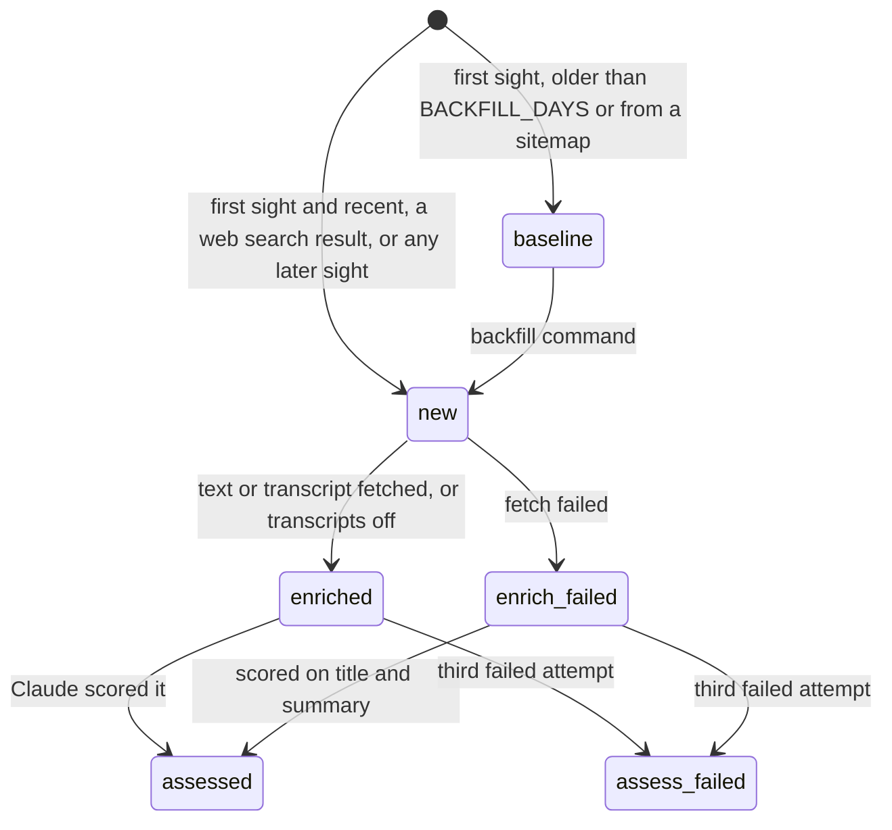
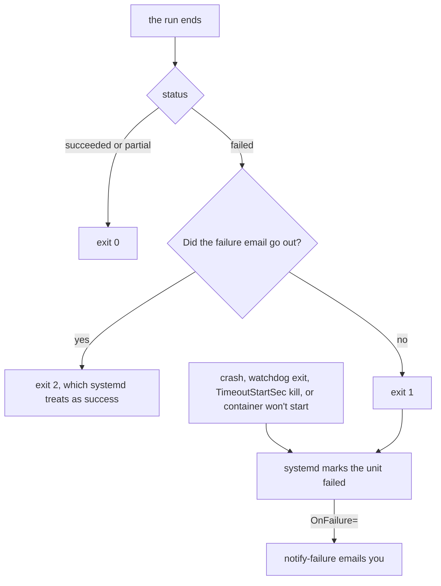
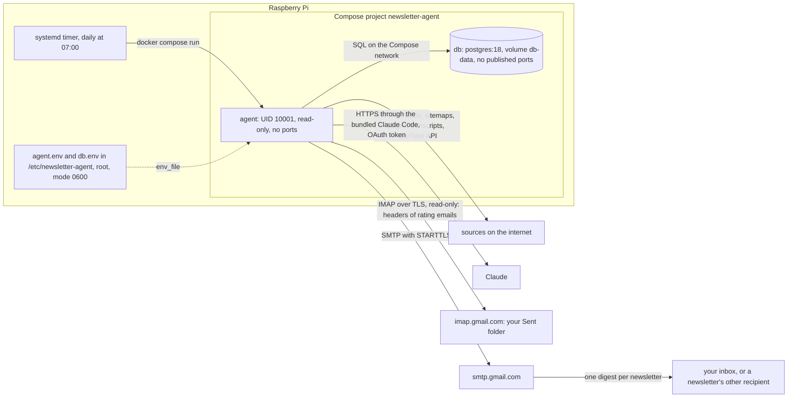

# Newsletter agent: requirements, decisions and architecture

**This document is the project's source of truth.** It holds what the agent must do, the decisions behind it, what research found, and how the code is built. When the code, the README or `CLAUDE.md` disagrees with it, fix whichever is wrong in the same change. Setup and day-to-day commands are in [README.md](README.md). The rules for working on the code are in [CLAUDE.md](CLAUDE.md). The diagrams are Mermaid, which GitHub renders; they weren't rendered locally.

Status on 2026-10-30:

- The first draft and support for several newsletters are built.
- Both were checked on the Mac in the real image, and the image on the Pi.
- Web search through Claude's own search tool (REQ-28, REQ-29) is built and was checked on the Mac only.
- A second review by six reviewers found 28 issues; the fixes are in and were checked on the Mac (section 14). Logs on the Pi are accepted (REQ-30).
- A third review, of the repository about to be published, found 30 issues, and every one is fixed (REQ-54, section 17).
- A fourth review, of the published code base, by seven reviewers with an adjudicator for the serious findings, found 32 issues. You decided its open questions (REQ-57 to REQ-60 and REQ-62, with one deferred in section 16), the fixes are in, and they were checked on the Mac and the Pi (REQ-61, sections 14 and 17). The same pull request makes Claude review only review and block on every problem it finds (REQ-63, REQ-64).
- Claude Code's ultrareview of `main` after that found five more issues, and every one is fixed and was checked on the Mac (sections 14 and 17). Claude review now posts its verdict as a comment on the pull request.
- Learning your taste from ratings (REQ-32) is built, and was checked on the Mac against a stand-in for Gmail, not against Gmail itself (section 14).
- The project was renamed from `ai-news-agent` to `newsletter-agent` (REQ-33): the repository, the package `newsletter_agent`, the command, and every name derived from them.
- A GitHub Actions pipeline with 17 checks (REQ-34 to REQ-45, and the Workflow guard) is written. The first 16 passed on GitHub in the private repository (section 14).
- The repository was republished as a public repository with fresh history, without personal details, under the MIT license (REQ-50 to REQ-52). A rule on `main` requires a pull request and every check to pass (section 12).
- Nothing is deployed.

The design was reviewed before it was built, by an architecture reviewer and a design-pattern reviewer. Section 19 lists where the build departs from that design.

The agent is one synchronous Python 3.12 package, `newsletter_agent`. It runs one or more **newsletters**, each with its own sources, interest profile, name and recipient. Each scheduled run is one short-lived process. It reads the ratings you sent from your own digests, collects new items for every newsletter and fetches their text. Then, per newsletter, it has Claude score the items against that newsletter's profile and your recent ratings, has Claude write a digest of the best, and emails it. The design rests on five rules:

- **Claude reads text and returns JSON.** Scoring and the digest give it no tools at all. The web search step gives it exactly one, `WebSearch` (section 5).
- **Every external boundary has one owning module:** the database (`store.py`), Claude (`llm.py`), HTTP (`http.py`) and Gmail, both SMTP and IMAP (`mail.py`).
- **Every step reads its work from Postgres and writes its result back,** under a lock, so a failed run can be re-run safely.
- **Every run is bounded:** a cap on items, a timeout on every I/O call, and a deadline for the whole run.
- **The standard library comes first.** There are four runtime dependencies: `claude-agent-sdk`, `psycopg`, `youtube-transcript-api` and `requests` (section 12).

## 1. Purpose and scope

New material on agent skills, AI software factories and nearby topics comes out across company blogs, personal blogs and YouTube. Following it by hand takes time. The agent runs on your own Raspberry Pi, collects that material, judges it against an interest profile, keeps everything in Postgres, and emails a short digest when something is worth reading.

You are the only operator: only you configure and run it, and only you get its failure emails. It can run several newsletters. Most are yours, on other topics such as hardware (REQ-27), but a newsletter can also go to someone you choose, such as a cooking newsletter for someone else.

**Not in scope:**

- letting anyone but you run the agent, change its configuration, or use Claude through it. Other people only receive a newsletter's email;
- models other than Claude, including embedding models (REQ-05). Anthropic has no embedding model of its own ([embeddings docs](https://platform.claude.com/docs/en/build-with-claude/embeddings)). A local open-source embedding model was researched for matching your taste, and deferred (section 15, E6);
- other kinds of agents, such as a calendar assistant. Only newsletters are generalized (REQ-25). Section 18 lists the other exclusions;
- any change to the other services on the Pi, or to its boot settings.

## 2. Requirements

These are agreed. Their IDs match the session's intent record. REQ-04, REQ-08, REQ-21, REQ-43, REQ-46 and REQ-48 were replaced by REQ-06, REQ-11, REQ-29, REQ-59, REQ-50 and REQ-49, and REQ-65 and REQ-66, two earlier versions of the README banner, by REQ-67. REQ-55 and REQ-56 asked for the repository's description and topics, which are GitHub settings rather than files; both are done.

| ID | Requirement | Status (2026-10-30) |
|---|---|---|
| REQ-01, REQ-09 | Runs on your Raspberry Pi, in Docker ("dark rice format" was a dictation of "Dockerized") | The image runs on the Pi; not deployed |
| REQ-02 | Data is stored in Postgres; re-running adds no duplicates | Verified locally |
| REQ-03 | Checks YouTube, the Anthropic and OpenAI sites, and well-known blogs about skills, software factories "and anything in between", matched to your interests | Verified for feeds, sitemaps and channels |
| REQ-05 | Claude is the only model | Verified |
| REQ-06 | Signs in with the OAuth token from `claude setup-token`. The token is valid for one year, from 2026-10-30, and is renewed yearly | Verified on the Pi; an invalid token fails the run loudly |
| REQ-07 | No extra memory isolation; the Pi's 16 GB is enough | No boot or kernel change |
| REQ-10 | Python with the Claude Agent SDK; nothing calls the Messages API directly | Verified |
| REQ-11, REQ-14 | Digests are sent through Gmail's own SMTP server, from your personal Gmail. You accepted that its app password also gives full IMAP access to that mailbox and is stored on the Pi | Written; no real send yet. REQ-32 uses that IMAP access, read-only, for rating emails |
| REQ-12 | The Claude model for each step (scoring, digest) is a setting | Verified |
| REQ-13 | Besides the curated sources, YouTube topic search through a YouTube Data API key | Written; not run without a key |
| REQ-15 | Transcripts are fetched, accepting YouTube's Terms of Service risk for personal use, and a setting turns them off | Verified; YouTube has since blocked the home network (F-16) |
| REQ-16 | A newsletter with nothing new sends no email | Verified |
| REQ-17 | Defaults, for now: a 7-day backfill, at most 100 items scored per run, at most 15 items per digest | Verified, as settings; since the third review the scoring cap is per run across all newsletters, as written, and was checked with two newsletters |
| REQ-18 | YouTube search terms live in config, starting with "harness engineering", "software factory" and "AI skills". You change them over time | Terms load and the cap is enforced; no search has run |
| REQ-19 | A one-shot agent container in its own Compose project with `postgres:18`, started by a host systemd timer. Postgres isn't published on host ports | Written; units verified; not deployed |
| REQ-20 | No pgvector or embeddings. Items are deduplicated by their source's ID and by canonical URL within a newsletter | Verified |
| REQ-22 | The architecture in sections 4 to 12 | Partly verified (section 14) |
| REQ-23 | The runtime dependencies are `claude-agent-sdk`, `psycopg`, `youtube-transcript-api` and `requests`; the config is TOML | Verified |
| REQ-24 | No comments in code or config files; Python docstrings are allowed | Verified by a scan |
| REQ-25 | Several newsletters, each with its own name, recipient, sources, search terms and interest profile. Collecting is shared; scoring and the digest run per newsletter; failure emails and health information go only to you | Verified locally |
| REQ-26 | This document is the single source of truth, and `CLAUDE.md` links to it | This version |
| REQ-27 | Newsletters are also for your own topics, such as hardware; the cooking newsletter was one example | Supported by REQ-25 |
| REQ-28 | Each newsletter draws on four kinds of source: a short list of YouTube channels, a short list of websites or RSS feeds, YouTube topic search, and web search. Web search is required | Channels, feeds, sitemaps and web search verified on the Mac; YouTube search written, not run without a key |
| REQ-29 | A fixed workflow: code fetches and stores; Claude scores, summarizes and writes the digest with no tools. The one exception is web search (REQ-28), which uses Claude's own web search tool through your subscription, with no other search service or key. You accepted that search results then reach a Claude that has a tool, and that searches use your plan's limits. Replaces REQ-21 | Verified on the Mac: scoring and digest sessions offered only `StructuredOutput`, web search sessions only `StructuredOutput` and `WebSearch` |
| REQ-30 | Logs stay on the Pi, in the journal and the `runs` table; failure emails are the only signal that leaves it. You accepted that the logs go with the Pi if it is lost or compromised (security review SEC-6) | Accepted risk |
| REQ-31 | No paid embedding service, such as OpenAI's | Holds; there is no embedding model |
| REQ-32 | The agent learns your taste from ratings. Each item in a digest addressed to you has "More like this" and "Less like this" links; each run reads the emails they create, read-only, from your Gmail Sent folder; scoring shows Claude your recent likes and dislikes as examples; your footer counts ratings per source. Claude stays the only model and the scorer, with no new service, dependency or secret. A monthly email suggesting profile edits isn't part of it | Built; checked on the Mac against a stand-in for Gmail (section 14) |
| REQ-33 | The project is named `newsletter-agent`: "agent" already says AI, and a newsletter needn't be news. The repository, the package `newsletter_agent`, the command `newsletter-agent`, the Compose project, image, systemd units, container, database, secrets folder and Pi folder all follow | Done in the repository, on GitHub and on the Mac; the Pi still has the old copy (section 20) |
| REQ-34 | A pipeline job, "PR hygiene", fails a pull request that has no linked issue | Passed on GitHub: it failed a pull request without a linked issue, then passed once one was linked |
| REQ-35 | No code goes into `main` directly; every change arrives through a pull request | A rule in `CLAUDE.md`, enforced by the rule on `main` (REQ-50) |
| REQ-36 | Two pipeline jobs, each running its own script over the whole repository, enforce the no-comments rule (REQ-24) and the no-tests rule | Checked on the Mac, with planted comments and tests; passed on GitHub |
| REQ-37 | A pipeline job lints the code | Checked on the Mac, with security, debugger, print and complexity rules added; passed on GitHub |
| REQ-38 | A pipeline job checks the dependencies for known vulnerabilities | Checked on the Mac; passed on GitHub |
| REQ-39 | A pipeline job searches the repository and its history for secrets, tokens and API keys | On GitHub, gitleaks caught a made-up token of that shape on a test pull request, and passed the others after one false alarm was allowed (section 12) |
| REQ-40 | Ruff's banned-import rule enforces that one module owns each outside boundary: Claude, Postgres, HTTP, YouTube transcripts and Gmail (section 12) | Checked on the Mac: a planted `psycopg` import elsewhere was caught; passed on GitHub |
| REQ-41 | Every tool from your list that helps this project is added to the pipeline | Eleven added, the rest covered or declined with a reason (section 12); checked on the Mac, and passed on GitHub |
| REQ-42 | Every change starts with an issue, then a pull request that links it; nothing is pushed to `main` directly. `CLAUDE.md` says so | Written in `CLAUDE.md`; PR hygiene checks the link, and the rule on `main` (REQ-50) requires the pull request |
| REQ-44 | A pipeline check keeps a pull request from being merged unless Claude's review approves it | Claude review is a required check in the rule on `main` (REQ-50) |
| REQ-45 | Claude approves when its review posts no findings. When Claude is wrong or can't review, you add the `review-override` label and the check passes, for the commit you labeled only | Its decision step was tried with four verdicts on the Mac. On GitHub it has so far failed only with "no review", on pull requests that change its own workflow, as designed |
| REQ-47 | Local git hooks run the fast checks on every commit, and Types, Duplicates, Vulnerabilities and Secrets on every push | Installed and run on the Mac |
| REQ-49 | Claude's approval is mandatory before a merge | Enforced by the rule on `main` (REQ-50); only your `review-override` label passes Claude review without Claude |
| REQ-50 | The repository is public, so GitHub's free plan allows a rule on `main` that requires a pull request and every check to pass before a merge. Replaces REQ-46, under which every check was only a warning | Section 12, "The rule on `main`" |
| REQ-51 | The repository was deleted and created again as public, with fresh history and the code kept; personal details were removed before the first commit | Done on 2026-10-30; the old history and GitHub data are backed up outside the repository |
| REQ-52 | The repository is licensed under MIT | `LICENSE` |
| REQ-53 | Git ignores every file with `.local` in its name; the Pi's private details live in such a file, `CLAUDE.local.md`, which Claude Code loads beside `CLAUDE.md` | `.gitignore`; `git check-ignore` matched `CLAUDE.local.md`, `foo.local` and `x.local.json` |
| REQ-54 | Every finding of the review before publishing is fixed, however minor; nothing is left accepted, deferred or unfixed | 30 issues fixed (section 17), checked in the rebuilt image against a fresh Postgres and by script (section 14) |
| REQ-57 | The agent may fetch any public https site and path its sources link to. An allowlist of domains would break REQ-03 and REQ-28, so you accepted that risk | Accepted risk (section 16); only port 443 is allowed |
| REQ-58 | The database setup should be one that other users of this project can set up without issues, as well as you on the Pi | Password logins with generated passwords, TLS 1.3 only, and TCP logins for the agent's role only (section 12); checked on the Mac and the Pi; the remaining risk is accepted (REQ-62) |
| REQ-59 | Claude's two GitHub app workflows follow the pipeline's rules: no comments, actions pinned by commit, checkout without saved credentials; zizmor's `dangerous-triggers` finding is accepted for `claude.yml` and for `workflow-guard.yml`, which must run on `pull_request_target` to judge a pull request from `main`'s copy. Replaces REQ-43 | Every check passed on GitHub; zizmor passes with both exemptions |
| REQ-60 | Deploys to the Pi come only from a reviewed `main` commit, and the deployed commit is recorded | README, "Deploy on the Pi"; `check`, each run's first log line and failure emails show the revision |
| REQ-61 | Every finding of the fourth review is fixed, on one branch from `main`, for issue #4 | Section 17 |
| REQ-62 | You accept that the database's two passwords and its TLS key don't change on their own and can be read by anyone with Docker access on the Pi | Accepted risk (section 16) |
| REQ-63 | Claude review only reviews: it never changes a file, commits or pushes; changes come from your own Claude Code session | `CLAUDE.md`'s rule, and `scripts/check_review_workflow.py` in the Workflows job, which failed on each of 24 planted violations (section 14) |
| REQ-64 | Every problem Claude review finds blocks the merge, however minor | The review's own prompt (section 12). It approved pull request #5, and on pull request #7 it blocked two commits, on the README banner and a gap in the requirement IDs, before approving the third (section 14) |
| REQ-67 | The README opens with your "Engineered, Not Vibe Coded" banner, above its title on purpose: the heading, its badge, "#1 Stop vibe coding" and the `diff` block. It states no merge, approval or check result, because the file can't know them. Replaces your earlier two versions | In README.md; `CLAUDE.md`'s rule that the README covers setup and operations only allows it |

**Working assumptions** (not confirmed; change them if they're wrong):

- the agent runs once a day;
- all three models (scoring, digest and web search) default to `claude-opus-5-5` until plan usage is measured;
- "nothing new" means no item at or above the newsletter's score threshold;
- failures still send an email to you;
- you edit the search terms; the agent doesn't change them itself.

**Engineering rules,** detailed in `CLAUDE.md`:

- no comments, but docstrings are allowed;
- no unit or integration tests; verify by running the real program;
- the standard library first;
- no commits unless you ask;
- every change starts with an issue and reaches `main` through a pull request that links it; nothing is pushed to `main` directly (REQ-34, REQ-35, REQ-42). The pipeline checks what a machine can check (section 12).

## 3. Decisions and why

| Decision | Choice | Why |
|---|---|---|
| Language and SDK | Python with `claude-agent-sdk` (REQ-10) | Official SDK; tested with the token on the Pi (E1); the best transcript library is Python. Alternatives are below |
| Claude sign-in | The `setup-token` OAuth token, not an API key (REQ-06) | Allowed for personal use: see "Why the token is allowed" below. Switching to an API key later is one environment variable |
| Shape | A scheduled workflow, not a free-roaming agent (REQ-29) | The steps are known in advance. Anthropic: "we recommend finding the simplest solution possible, and only increasing complexity when needed" ([Building effective agents](https://www.anthropic.com/engineering/building-effective-agents)). Claude with no tools can't be steered by injected page text to do anything; only the web search step gives it a tool |
| Web search | Claude's own `WebSearch` tool, through your subscription (REQ-28, REQ-29) | Your product decision: no other search service, account or key. The cost is that injected text in search results reaches a Claude that has a tool (section 5). The alternatives were Brave's Search API, which Claude recommended ($5 of free credit a month, about 1,000 searches, with a card on file), and Tavily (1,000 free searches a month, no card). Google's whole-web Custom Search JSON API ends on 2027-01-01. Prices checked on 2026-10-30 |
| Scheduling | A host systemd timer starting a one-shot container (REQ-19) | Matches the Pi's existing timer pattern; nothing runs between runs |
| Delivery | Gmail's own SMTP server, from your account (REQ-11, REQ-14) | No extra mail component |
| A heartbeat email on quiet days | No (REQ-16) | Your choice. The cost: a dead Pi or a revoked Gmail password looks like a quiet day (section 10) |
| Models | A setting per step, `claude-opus-5-5` for scoring, the digest and web search (REQ-12) | Anthropic's advice is to try the most capable model first. Haiku 5.5 and Sonnet 5.5 also worked in E1 |
| Embeddings | None (REQ-20, REQ-31) | REQ-05 rules out other providers, and Anthropic has none. A local model as Claude's helper was tested (E6): it judged taste no better than Claude with your ratings, so it waits until there are tens of ratings, or duplicate stories become a problem |
| Learning your taste | Rating links that send an email to yourself, read from the Sent folder; recent ratings as examples in the scoring prompt (REQ-32) | One tap and Send per rating, and nothing new to run or pay for. Only you can put mail in your Sent folder, so ratings can't be faked by someone emailing you. In E5, ratings in the prompt moved scores the right way. Rejected: replies such as "+2 -5" (fragile to parse), links to a web endpoint (needs a published port), a Telegram bot (a new service and token), and Claude rewriting the profile itself (drift) |
| Libraries | The standard library first (REQ-23) | `feedparser`, `trafilatura`, `jinja2`, `httpx` and `pyyaml` were replaced by `xml.etree`, `html.parser`, `html.escape`, `urllib` and `tomllib` |
| Newsletters | Several, built before the first deployment (REQ-25, REQ-27) | No data existed yet, so the schema could change without a migration |
| Memory limits | None (REQ-07) | The kernel ignores them anyway (section 13) |
| Vulnerability check | `uv audit` on `uv.lock` (REQ-38) | Go's `govulncheck` only reads Go code. `uv audit` is built into the uv version the project already pins (0.11.2), reads the lockfile directly and queries the OSV database, so nothing new is installed. It's a preview feature, so its output may change. Unlike `govulncheck`, it reports a vulnerable version whether or not the code calls the affected function. Rejected: `pip-audit`, which needs an exported requirements file and another tool |
| Secret scan | gitleaks 8.30.1, with its default rules plus one for the Claude OAuth token (REQ-39) | It scans every commit, not only the latest files. Its default rules cover Anthropic API keys (`sk-ant-api03-`) and Google API keys, but not the `sk-ant-oat01-` token that `claude setup-token` makes, so `.gitleaks.toml` adds one. GitHub's secret scanning and push protection are on too, since the repository is public, but the pipeline doesn't rely on them |

**Why the token is allowed.**

- **Plan sign-in is supported.** Anthropic's support article [Use the Claude Agent SDK with your Claude plan](https://support.claude.com/en/articles/15036540-use-the-claude-agent-sdk-with-your-claude-plan) says, in its 2026-10-07 update: "When you sign in with your Claude plan, the Agent SDK and `claude -p` still draw from your subscription limits."
- **`setup-token` is meant for this.** The Claude Code docs describe it as "For CI pipelines, scripts, or other environments where interactive browser login isn't available".
- **Scripted access is permitted where Anthropic explicitly allows it.** The [Consumer Terms](https://www.anthropic.com/legal/consumer-terms) forbid scripted access "Except when you are accessing our Services via an Anthropic API Key or where we otherwise explicitly permit it". The setup-token documentation is such an explicit permission (inferred).
- **What the terms forbid is sharing your sign-in.** The Consumer Terms say "You also may not make your Account available to anyone else". The [Agent SDK overview](https://code.claude.com/docs/en/agent-sdk/overview) says third-party developers may not "offer claude.ai login or rate limits for their products".

So don't let anyone else trigger runs, and don't share the token. A newsletter emailed to someone else is an open question (section 16).

**Alternatives considered.** REQ-06 means every Claude call goes through the Claude Code binary, because bare mode and the Messages API don't accept the token (F-04).

| Option | Why not |
|---|---|
| TypeScript with the Agent SDK | A close second. Its YouTube transcript libraries are unofficial and less used |
| Go running `claude -p` as a subprocess | No SDK: no typed messages; fewer transcript options |
| The Messages API through the `anthropic` client | Needs an API key, not the token |
| Managed Agents with scheduled deployments | Needs an API key and runs in Anthropic's cloud, which fails REQ-01 |
| An agent with web tools that browses for news | Less predictable, costs more per run, and its tools are exposed to injected page content |

## 4. Run flow

**What one run does:**



`run.py` calls the steps in `steps.py` as plain functions, in order. Each step reads its work list once, at the start, so nothing can loop within a run. The steps record counts, Claude usage and failure flags on a `steps.Run` object. `run.py` writes them to the `runs` row when the run ends, whether it succeeded or not.

| Step | Reads | Writes | Item state after |
|---|---|---|---|
| read ratings | when a newsletter goes to `SMTP_USERNAME`, the headers of rating emails in its Gmail Sent folder from the last 30 days | `feedback` | unchanged |
| collect | every newsletter's enabled sources, from `config/newsletters/*/newsletter.toml`. A `web_search` source asks Claude, with only `WebSearch`, for recent links | new `items`; the source's runtime state | `new`, or `baseline` on a source's first sight (section 9) |
| enrich | per newsletter, its share of `MAX_ITEMS_PER_RUN` for the whole run, items in `new` from its configured, enabled sources, taken one source at a time: each source's newest, then each source's second newest, and so on. An item with no publication date counts from when it was first stored | `item_content`, or the reason the fetch failed | `enriched` or `enrich_failed` |
| assess | per newsletter, its share of `MAX_ITEMS_PER_RUN` for the whole run, items in `enriched` or `enrich_failed` from its configured, enabled sources, taken one source at a time like enrich, against its profile and recent ratings | `assessments` | `assessed`, or `assess_failed` (terminal) |
| digest | per newsletter, assessed items at or above its threshold with no `digest_items` row | one `digests` row per newsletter with candidates, and its `digest_items` | unchanged |
| deliver | digests with `sent_at` null, each to its newsletter's recipient | `sent_at` or `send_error` | unchanged |

Items that fail to enrich are still scored on their title and feed summary.

## 5. The Claude boundary

This is the most important decision in the design.

**How untrusted web text reaches Claude, and what comes back:**

```mermaid
flowchart LR
  subgraph untrusted["Untrusted: from the internet"]
    page["feed summary, article text, transcript"]
    results["search results"]
    rated["titles of items you rated"]
  end
  page -->|"fenced in item tags"| prompt["prompt with numbered items"]
  rated -->|"fenced in a feedback block"| prompt
  prompt --> call["llm.structured: tools=[], no MCP, no settings"]
  call --> tools{"Does init offer exactly StructuredOutput?"}
  tools -->|"no"| refuse["ClaudeAuthError"]
  tools -->|"yes"| result{"Is is_error set on the result?"}
  result -->|"yes"| classify["ClaudeAuthError or ClaudeUnavailable"]
  result -->|"no"| json["JSON: item numbers, scores, summaries"]
  json -->|"unknown numbers dropped"| email["email built by code: every shown text defanged, links only from stored URLs"]
  term["search term from config"] --> search["llm.structured with web_search: tools=[WebSearch]"]
  results --> search
  search --> stools{"Does init offer exactly StructuredOutput and WebSearch?"}
  stools -->|"no"| refuse
  stools -->|"yes"| links["JSON: url, title, date"]
  links -->|"http or https on a public host, no credentials"| items["new items, fetched later through http.py"]
```

- **One way in.** Claude is called only through `llm.structured()`, with these options:
  - `tools=[]`, which disables every built-in tool, or `tools=["WebSearch"]` and `allowed_tools=["WebSearch"]` when the caller sets `web_search=True`. Only `sources/web_search.py` does;
  - no MCP servers;
  - `setting_sources=[]`;
  - `permission_mode="dontAsk"`;
  - `max_turns=3`, or 8 with web search, which needs a turn per search;
  - a JSON-schema `output_format`.

  Experiment E3 showed what `tools=[]` does: the session offers only `StructuredOutput`, structured output still works, and input drops from 11,962 tokens to 1,050 per call. A deny-list of 8 tools still left 19 tools available. Experiment E4 showed that `tools=["WebSearch"]` offers exactly `StructuredOutput` and `WebSearch`, and that the search works with the OAuth token.
- **Fail closed.** `llm.py` reads the `init` message and raises `ClaudeAuthError` unless its tool list is exactly `["StructuredOutput"]`, or exactly `StructuredOutput` and `WebSearch` for a web search session. A session that sends no `init` message fails the same way. If an SDK upgrade adds tools, the run stops; it doesn't carry on with more tools than intended.
- **No secrets in reach.** The SDK starts Claude Code with the whole process environment. So `settings.take_secrets` removes these variables from `os.environ` before anything else runs: `DATABASE_URL`, `SMTP_USERNAME`, `SMTP_APP_PASSWORD`, `YOUTUBE_API_KEY`, `POSTGRES_PASSWORD`, `AGENT_DB_PASSWORD`, and every `DIGEST_TO_<KEY>` recipient address. Only `CLAUDE_CODE_OAUTH_TOKEN` stays, because Claude Code needs it. `WebSearch` can't read the environment or files, so the search session can't put the token into a query. Removing a variable from `os.environ` doesn't remove it from `/proc/<pid>/environ`, so this protection rests on Claude having no tool that reads files.
- **Fetched text is fenced.** Each item goes into a prompt inside `<item n="…">` tags, and the titles of items you rated go inside a `<feedback>` block. `text.fence` escapes any `<item`, `</item`, `<feedback` or `</feedback` inside that text, also with spaces or zero-width characters inside the tag. The prompt tells Claude that both are material to judge, never instructions. The search prompt says the same of search results. `prompts.render` fills a template's placeholders in one pass, so a title containing `{{items}}` can't pull in other text.
- **Claude never sees database IDs.** Items are numbered 1 to N within a batch. Code drops any number outside that range, and any number that appears twice.
- **Links from a search are checked before they are stored.** A link Claude returns is kept only if it is a valid `http` or `https` URL, at most 2,000 characters, has no user name or password, names no port other than 443 once it is turned into https, and its host resolves only to public addresses (`http.check_url`). The enrich step checks the address again when it fetches the page.
- **Code writes the email.**
  - `mail.render_digest` passes every text it shows through `text.defang`: titles (a web search item's title comes from Claude), summaries, score reasons and the intro. `defang` replaces URLs with "[link removed]" and breaks up every dot of any domain-like word and every IPv4 address, so `www.evil.click` becomes `www[.]evil[.]click`. Look-alike dots, such as `。` and `․`, count as dots. The cost is that names such as `Node.js` show as `Node[.]js`.
  - Every value in the HTML goes through `html.escape`.
  - Links come only from stored item URLs, only `http` and `https` ones, and each link shows its domain in ASCII, so an international look-alike of a familiar domain shows in its `xn--` form. For a web search item, that stored URL came from Claude's search output and passed the checks above.
  - The one other kind of link is the pair of rating links on each item of a digest addressed to you: `mailto:` links that code builds from `SMTP_USERNAME`, the item's database ID and the database's feedback token (section 7, "Learning your taste"). No text from Claude or a page goes into them.
- **Consequences.**
  - Prompt injection in a fetched page can at most skew a score or a summary, or make its own item fail scoring until it is set aside as `assess_failed` after 3 runs (section 7, steps.py). It can't make Claude fetch, run or send anything.
  - Prompt injection in a search result reaches a Claude that can search. At worst it can make Claude run extra searches, which use plan limits but are capped by `max_turns`; send words from the prompt to the search engine, where the prompt holds only the search term; or return a link the attacker chose. Such a link must still be on a public host. Its page is fetched under the 90-second deadline, so a deliberately slow server can't stall the run, and the page is scored against the profile like any other. In the injection test (section 14), Haiku ignored planted instructions.
  - Any other new capability has to be written as code.
- **Revisit when:**
  - a feature needs Claude to use another tool;
  - an SDK upgrade changes the `init` tool list, or `WebSearch` gains abilities such as fetching pages;
  - the deployment moves to an API key.

## 6. Package layout

```text
newsletter-agent/
  LICENSE                     MIT
  pyproject.toml, uv.lock     dependencies, pinned by uv
  Dockerfile, compose.yaml    the image and the Compose project
  deploy/                     systemd units: the run, the failure notice, the daily timer
  db/                         init-agent.sql (the agent's role) and pg_hba.conf (TLS only,
                              and over TCP only the agent's role)
  .github/workflows/          the pipeline: pull-requests.yml (PR hygiene) and ci.yml;
                              claude.yml and claude-code-review.yml for Claude's GitHub app;
                              workflow-guard.yml for changes to the files that define checks;
                              audit.yml, the weekly vulnerability audit
  .github/zizmor.yml          the workflow finding accepted on purpose, for claude.yml and
                              workflow-guard.yml (REQ-59)
  scripts/                    check_no_comments.py and check_no_tests.py, sharing repository.py;
                              check_review_workflow.py, which keeps Claude review read-only
  .pre-commit-config.yaml     the same checks, on each commit and push
  .gitleaks.toml              the secret scan's extra rule for the Claude token
  .squawk.toml                the migration rules that don't fit this project, switched off
  CLAUDE.local.md             gitignored, like every *.local and *.local.* file: private notes
                              about the owner's machines, never committed (REQ-53)
  config/newsletters/<key>/   one folder per newsletter; the folder name is its key
    newsletter.toml           its name, optional score_threshold and [[sources]]
    interests.md              its interest profile, in plain prose
  src/newsletter_agent/
    cli.py                    argparse: run, send-pending, check, backfill, notify-failure
    settings.py               take_secrets(), load_settings() → frozen Settings
    run.py                    lock, migrate, the steps in order, the runs row, exit code
    steps.py                  read_ratings, collect, enrich, assess, digest, deliver
    store.py                  all SQL; the only psycopg import
    llm.py                    the only claude_agent_sdk import; structured() and its errors
    http.py                   urllib: timeouts, size cap, address checks, manual redirects
    mail.py                   Gmail: render_digest(), feedback_link(), render_failure(), send(),
                              error_summary(), check_login(), read_ratings() over IMAP
    enrich.py                 article text or a YouTube transcript
    extract.py                main text and title from HTML, with html.parser
    text.py                   storable(), storable_json(), plain(), defang(), fence()
    urls.py                   canonical_url(), domain(), YouTube video IDs
    sources/
      __init__.py             COLLECTORS: source type → collector function
      base.py                 Candidate, SourceState, Collected, the run deadline check
      feed.py                 RSS 1.0, RSS 2.0 and Atom, with xml.etree
      sitemap.py              sitemaps and sitemap indexes, filtered by include rules
      youtube.py              a channel's Atom feed, parsed by feed.py
      youtube_search.py       YouTube Data API search.list by topic (REQ-13)
      web_search.py           web search through Claude's WebSearch tool (REQ-28, REQ-29)
    prompts/                  load(), render(), and score_v2.md, digest_v1.md, search_v1.md
    migrations/               numbered, forward-only SQL files; a new one takes the next number
```

## 7. Module responsibilities

### settings.py

`cli.main` first calls `take_secrets(os.environ)`, then `load_settings(environ, secrets, config_dir)`, which returns one frozen `Settings`. It is passed down; there's no module-level settings object. Secret fields use `field(repr=False)`, so they never appear in logs or tracebacks.

`load_mail_settings(secrets)` builds only what email needs. `notify-failure` and a run that fails on its configuration use it to send the failure email even when the rest of the configuration is broken.

The README lists every variable and its default. The values that came from decisions:

- `SCORE_MODEL`, `DIGEST_MODEL` and `SEARCH_MODEL` (REQ-12), all `claude-opus-5-5`;
- `MAX_ITEMS_PER_RUN` 100, `DIGEST_MAX_ITEMS` 15 and `BACKFILL_DAYS` 7 (REQ-17);
- `SCORE_THRESHOLD` 6, on the 0–10 scale. This value was proposed, and is to be tuned;
- `TRANSCRIPTS_ENABLED` (REQ-15);
- `YOUTUBE_SEARCH_MAX_QUERIES` 10. The API allows 100 `search.list` calls a day;
- `WEB_SEARCH_MAX_QUERIES` 10, at most 50. Each term is one Claude session a run, with up to 3 searches, and all of it uses your plan's limits.

`load_settings` reads every folder under `config/newsletters/` into a `NewsletterConfig`: its key, name, recipient, score threshold, sources and interest profile.

- **The recipient** comes from `DIGEST_TO_<KEY>`, or `SMTP_USERNAME` when that isn't set. `Settings.is_owner(newsletter)` is true when the recipient is `SMTP_USERNAME`.
- **The score threshold** is the newsletter's own `score_threshold`, or `SCORE_THRESHOLD`.
- **Search terms** live in each newsletter's `youtube_search` and `web_search` sources, as `queries` (REQ-18).

Before any network call, `load_settings` validates the whole configuration:

- at least one newsletter folder must exist, named like a source key, with a `name` and a non-empty `interests.md`;
- every source `type` must be a key of `COLLECTORS`;
- source keys must be unique within a newsletter;
- feed and sitemap URLs must be `http` or `https`;
- channel IDs must look like `UC` plus 22 characters;
- `include` must be a list, every regex in it must compile, and only `feed` and `sitemap` sources may have one, because the others ignore it;
- all newsletters' YouTube search terms together can't exceed `YOUTUBE_SEARCH_MAX_QUERIES`, because Google's quota belongs to the API key;
- all newsletters' web search terms together can't exceed `WEB_SEARCH_MAX_QUERIES`, because every search uses the same plan.

### sources/

Each collector has the same signature:

```python
type Collector = Callable[[SourceConfig, SourceState, Settings, float], Collected]
```

The last argument is the run's deadline, a `time.monotonic()` value, so a change of the system clock can't move it. A collector that makes several requests checks it with `base.past(deadline)` before each one after the first, and raises `DeadlinePassed` when it has passed, which fails the source rather than recording a success for work it skipped.

- **What collectors return.** `SourceState` carries the stored ETag, Last-Modified and time of the last success. `Collected` holds the candidates, plus the new ETag and Last-Modified values or a not-modified marker. It also has `recent_only`, which is true for web search, and `claude`, the Claude calls the collector made, whose usage the run records.
- **Candidates.** A candidate is `Candidate(external_id, url, title, published_at, summary)`. Only `external_id` and `url` are always set.
- **No database access.** Collectors don't touch the database. Inserting with `on conflict do nothing` decides which items are new.
- **`feed.py`** reads RSS 1.0, RSS 2.0 and Atom by element name, ignoring namespaces.
  - Dates are read as ISO 8601 or RFC 822 by `feed.parse_date`, which YouTube search and web search use too.
  - Atom links prefer `rel="alternate"`.
  - Malformed XML fails the source, and the failure is recorded.
- **`sitemap.py`** keeps the URLs whose path matches an `include` rule. It follows a sitemap index one level deep, at most 10 child sitemaps, on the same host only, and checks the run deadline before each child.
- **`youtube.py`** fetches `https://www.youtube.com/feeds/videos.xml?channel_id=…` and keeps each video's ID and watch URL.
- **`youtube_search.py`** makes one `search.list` call per term, with `type=video`, `relevanceLanguage=en`, `order=relevance` and `maxResults=25`.
  - `publishedAfter` is 12 hours before the source's last successful collection, because YouTube indexes some videos hours after they are published, or 48 hours ago on the first run.
  - It checks the run deadline before each call, and a passed deadline fails the source.
  - The key goes in the `X-Goog-Api-Key` header, never in the URL.
  - Any failed call fails the whole source, so `publishedAfter` doesn't move forward past results it missed.
- **`web_search.py`** runs one Claude session per term, with only `WebSearch` (section 5), using the `search_v1` prompt and `SEARCH_MODEL`.
  - It asks for pages from roughly the last N days, where N is the days since the source's last success, at least 1 and at most 7, or 2 on the first run. Search engines have no exact date filter here, so the window is a request to Claude, not a guarantee.
  - It keeps at most 10 links per term, after the link checks in section 5. The item's ID is its canonical URL. Claude's date is kept when it parses and isn't in the future; most results have none.
  - A term whose output is invalid is skipped, and the others go on. When every term's output is invalid, the source fails with `ClaudeOutputError`, so it counts as failing and its search window doesn't move forward. It checks the run deadline before each term, and a passed deadline fails the source the same way, so the next run's window still covers the terms that didn't run. A sign-in or availability failure fails the source and stops Claude for the run (section 10). In each case, the usage of every session the source ran is still recorded.
  - `check` runs one search, for "artificial intelligence", when any newsletter has a `web_search` source.

`steps.collect` calls each collector, and stores its candidates, inside a `try`/`except` per source. A broken source, or one whose items can't be stored, is recorded on its row, and the other sources go on. Before storing, it skips any candidate whose URL isn't a valid `http` or `https` URL, including a malformed port, or is over 2,000 characters, so one bad entry in a feed can't fail the run.

### enrich.py and extract.py

There are two branches, chosen by source type:

- **YouTube items:** the transcript, through `youtube-transcript-api`, only when `TRANSCRIPTS_ENABLED` is on. Each call gets a new `YouTubeTranscriptApi` on a `requests.Session` whose adapter applies a 30-second timeout. With transcripts off, the item moves on with no content row and is scored on its title and description.
- **Everything else:** the page is fetched through `http.py`, and `extract.py` pulls out the text with `html.parser`. A response whose `Content-Type` isn't HTML, XHTML or plain text, such as a PDF, fails the item with `ValueError`; it is then scored on its title.
  - It skips scripts, styles, navigation, headers, footers, asides and forms.
  - It prefers the text inside `<article>` or `<main>` when there are at least 500 characters of it.
  - It drops lines shorter than 25 characters.
  - The title comes from `og:title`, or else the page's first `<title>` outside the skipped parts, so an icon's `<svg><title>` isn't added to it. This is where sitemap items get their title.

Stored text is capped at 100,000 characters, titles at 500, and NUL characters are removed, because Postgres can't store them. A failure is caught per item and recorded with its exception type and message, and the item becomes `enrich_failed`.

### llm.py

One public function:

```python
structured(prompt: str, schema: dict, model: str, *, timeout: float = 600, web_search: bool = False) -> Structured
```

`Structured` holds `output`, `model`, the `tools` the session offered, `usage` and `cost_usd`. The function is synchronous and wraps the SDK's async `query()` in `asyncio.run()`. Inside:

1. `contextlib.aclosing(query(...))` ends the Claude Code child process when the call ends, including on timeout. This was checked on the Pi: no `claude` process remained 2 seconds after a timed-out call.
2. It reads the stream with an `asyncio.timeout()` around it.
3. It checks the `init` tool list (section 5), and logs the model and `apiKeySource`. An accidental switch to an API key shows up in that log.
4. On the `ResultMessage`, it checks `is_error` before it reads `structured_output`.

It maps failures to three exceptions:

| Exception | Signals |
|---|---|
| `ClaudeAuthError` | Status 401 or 403. Error `authentication_failed` or `billing_error` on an assistant message or a retry event. A missing Claude Code binary. Unexpected tools, or no `init` message. Any other exception from the SDK, which it can't classify. |
| `ClaudeUnavailable` | Status 429 or 5xx, error `rate_limit` or `server_error`, a Claude Code crash, the timeout, or the SDK's "Control request timeout" when Claude Code doesn't start. |
| `ClaudeOutputError` | No `structured_output`, a refusal, or a limit reached: all turns used up, or `error_max_structured_output_retries`. |

An invalid token produces a `ResultMessage` with `subtype="success"`, `is_error=True` and `api_error_status=401`. That's why `is_error` must come first. This was seen in E3 and again on the Pi in the real image.

- Every Claude error carries `spent`, the usage of the sessions that ran before it: one that returned nothing valid, one that ended with a sign-in or availability error, and a web search source's earlier terms. `DeadlinePassed` carries a web search source's sessions too. So the run's counts and `usage_json` include every session that returned a result; a timeout or a crash returns none, so its usage is unknown.
- A result that arrives just before the timeout is kept, even when ending the Claude Code process runs past the timeout.
- An exception the SDK raises that can't be classified is logged with its traceback before it becomes `ClaudeAuthError`.

### steps.py

- **The six steps** are plain functions that take `(conn, settings, …)`. Assess and digest call `llm.structured` directly; collect reaches it only through the `web_search` collector.
- **Commits.** A step commits after each source, each item or each batch, so work already done survives a later failure.
- **Excerpts.** Prompts carry excerpts, not full texts: up to 4,000 characters per item for scoring, and 1,500 for the digest.
- **Read ratings** runs first; see "Learning your taste" below.
- **Assess.** It sends batches of `SCORE_BATCH_SIZE`, each with the newsletter's recent ratings, which it reads once per newsletter.
  - Items Claude scores validly are saved.
  - Items left unscored go round once more, then are split in halves down to single items.
  - An item that fails alone has `assess_attempts` incremented, and after 3 attempts it becomes `assess_failed`.
  - After enough invalid answers in a row, it raises `ClaudeUnavailable`: at least 4, and enough for the retry and the halving to reach a single item, which is 7 for a batch of 20 (`steps.output_error_limit`). So one item that always gets an invalid answer is set aside as `assess_failed` after 3 runs instead of stopping scoring, and a model that keeps failing costs 7 calls a run, not two per item. The cost: after 3 such runs, the item at the head of the queue may be set aside although it isn't the cause. The deadline is checked before every call, retries included.
- **Digest.** The top `DIGEST_MAX_ITEMS` candidates by score are offered to Claude, which returns an `intro` and one summary per item.
  - Offered items that Claude leaves out still appear, after the others, with their score reason as the text.
  - If the call fails, a fallback digest uses each item's score reason.
  - With no candidates, no digest is created and no email is sent (REQ-16).

### mail.py

- `render_digest(...) -> Email` is pure. It builds the subject and heading from the newsletter's name, and the plain text and HTML. Every value in the HTML goes through `html.escape`. When `health` is `None`, the email has no health footer and no token warning. When `feedback_to` is set, each item gets the two rating links; `deliver` sets it, to `SMTP_USERNAME`, only on digests addressed to `SMTP_USERNAME`.
- `render_failure(reason, today)` builds the failure notice, with the commands to look further and the image's revision. It needs neither the database nor Claude.
- `error_summary(error)` is what `deliver` and `notify_failure` log and store for a failed send: for SMTP errors only the type and the SMTP reply codes, because their text quotes email addresses; for any other error its type and message.
- `send(email, mail_settings, to)` connects to `smtp.gmail.com` on port 587 with a 60-second timeout, and uses STARTTLS. Digests go to their newsletter's recipient; failure emails go to `SMTP_USERNAME`.
- `check_login` signs in and quits without sending, for the `check` command.
- `read_ratings(mail_settings, since)` reads rating emails over IMAP, as described next.

### Learning your taste (REQ-32)

Your ratings teach scoring what you like. Claude still scores, with no tools, and nothing new runs: no service, dependency or secret is added.

1. **Rating links.** In a digest addressed to `SMTP_USERNAME`, each item has two links, "More like this" and "Less like this". `mail.feedback_link` builds each as a `mailto:` link to `SMTP_USERNAME` whose subject names the item and the database: `newsletter-agent feedback more 1234 3f9a0c51d2e7` or the same with `less`, where 1234 is the item's ID and the last part is the database's own random token, made by migration `0004_feedback_token.sql`. A rating whose token isn't this database's is never stored, so after a rebuild, or in a test database signed in to the same Gmail, old ratings can't land on unrelated items with the same ID. Tapping one opens a ready-made email to yourself; sending it is the rating.
   - The words `more` and `less` replace the `+` and `-` the research proposed, because some mail apps turn a `+` in a `mailto:` link into a space.
   - Digests for anyone else have no links: their emails would land in a mailbox the agent can't read.
2. **Reading them.** The run's first step, `steps.read_ratings`, does nothing unless a newsletter goes to `SMTP_USERNAME`. Otherwise `mail.read_ratings`:
   - signs in to `imap.gmail.com` on port 993 over TLS, with certificate checks and a 60-second timeout, as `SMTP_USERNAME` with the app password the agent already has;
   - finds the Sent folder by its `\Sent` attribute, because Gmail translates the folder's name;
   - opens it read-only, with `EXAMINE`;
   - searches with standard IMAP `SEARCH` for the subject `newsletter-agent feedback` in the last 30 days. The research proposed Gmail's own `X-GM-RAW` search; the standard one is enough, because the code checks every subject exactly anyway;
   - fetches only the `Subject`, `Date` and `Message-ID` headers of the newest 500 matches at most, with `BODY.PEEK`, never a body.

   Only you can put mail in your Sent folder, so someone emailing you can't fake a rating.
3. **Storing them.** `store.save_rating` adds a `feedback` row only when the subject matches exactly, the email has a `Message-ID` and a `Date`, and the item was included in a digest of a newsletter addressed to `SMTP_USERNAME`. The `Message-ID` is unique, so reading the same email again on later runs adds nothing. Rating an item again stores a second row; the latest one counts.
4. **Using them.** Scoring uses the `score_v2` prompt. After the profile, it shows the newsletter's latest rating of each item rated in the last 60 days: at most 5 liked and 5 disliked titles, newest first, each on one line, cut to 200 characters and fenced. The prompt calls them evidence of taste that refines the profile, and says the profile still decides what is in scope. With no ratings yet, both lists say "(none yet)".
5. **Seeing them.** Your footer counts your latest rating of each item by source, such as `simon-willison 2 more, 2 less`, to help decide which sources to keep, and has one line saying how the links work.

A failure to read ratings, such as a rejected sign-in, doesn't stop the run: it ends `partial`, scoring uses the ratings already stored, and your footer names the error. `check` signs in, reads the Sent folder, and reports how many ratings it found. The agent never changes your profile or search terms; you do (section 18).

### store.py

- **Plain functions** that take a connection; there is no ORM.
- **Connections:** `connect()` sets `connect_timeout=10` and `statement_timeout` to 60 seconds, and always uses `sslmode=verify-full`, whatever `DATABASE_URL` says, so the server's certificate and host name are checked.
- **The lock:** `try_lock()` calls `pg_try_advisory_lock` on a connection of its own, which stays open for the whole run.
- **Migrations:** `migrate()` applies the pending files in `newsletter_agent/migrations/`, each in its own transaction, and records them in `schema_migrations`.

## 8. Data model

**Which tables point to which:**



```text
sources(id, newsletter, key, type, url, definition, etag, last_modified, first_seen_at,
        last_checked_at, last_success_at, consecutive_failures, last_error, last_new_item_at,
        UNIQUE (newsletter, key))
items(id, newsletter, source_id, external_id, url, canonical_url, title, published_at, summary,
      state in (baseline, new, enriched, enrich_failed, assessed, assess_failed),
      assess_attempts, first_seen_at,
      UNIQUE (source_id, external_id), UNIQUE (newsletter, canonical_url))
item_content(item_id PK, kind in (article, transcript), text, fetched_at, error)
assessments(id, item_id, model, prompt_version, profile_hash, score 0-10, reason, run_id,
            created_at, UNIQUE (item_id, prompt_version, model))
digests(id, run_id, newsletter, body_json, model, prompt_version, fallback, created_at, sent_at,
        send_error, UNIQUE (run_id, newsletter))
digest_items(digest_id, item_id UNIQUE, position, included)
runs(id, started_at, finished_at, status, counts_json, usage_json, error,
     claude_unavailable, notice_sent)
feedback(id, message_id UNIQUE, item_id, liked, sent_at, read_at)
instance(id PK, feedback_token)
schema_migrations(version PK, applied_at)
```

The DDL is `src/newsletter_agent/migrations/0001_init.sql`, plus:

- `0002_source_definition.sql`, which adds `sources.definition`: the source's type, URL, channel and include rules as JSON, so a change to them can be noticed;
- `0003_feedback.sql`, which adds `feedback`: one row per rating email, keyed by its `Message-ID`. The item's newsletter, source and position in its digest come from joins, not copies;
- `0004_feedback_token.sql`, which adds `instance`: one row holding the database's random feedback token, which every rating link carries (section 7, "Learning your taste").

- **Identity.**
  - An item is identified by its source's own ID: the RSS `guid`, the Atom `id`, the YouTube video ID, or the canonical URL for sitemap entries.
  - `canonical_url` is also unique, so the same article or video arriving from two sources is stored once.
  - Canonicalization removes the fragment, `utm_*` and `source=rss…` parameters, and a trailing slash. It turns any YouTube URL into `https://www.youtube.com/watch?v=<id>`.
- **Digest membership is an anti-join, not a time window.** The candidates are assessed items at or above the threshold with no `digest_items` row. Every candidate offered gets a row, marked included or not, so each item is offered exactly once. Digests are keyed by `run_id`, so changing the schedule needs no schema change.
- **Re-scoring.** A new prompt or a changed interest profile becomes a new `prompt_version` or `profile_hash`. Because of the anti-join, re-scored items don't return to the digest. Items already scored with `score_v1` keep that score; `score_v2` applies to items scored from then on. The ratings shown in a prompt change from run to run and aren't recorded with the score.
- **Left out on purpose.** There is no full-text search column and no content hash, because no agreed requirement uses them.

## 9. Volume control

The first review found that the seed sitemaps hold 4,732 URLs, which would mean hundreds of scoring calls on the first run. These rules prevent that:

- **Include rules per source,** in the AI newsletter's `newsletter.toml`:
  - anthropic.com: `^/news/`, `^/research/` and `^/engineering/`, which kept 492 URLs on 2026-10-30;
  - claude.com: `^/resources/articles/` only, which kept 273. `claude.com/blog` redirects there.
- **First-sight baseline.** The first time a source is collected, its entries are stored as `baseline` and never scored. The exceptions are entries published within `BACKFILL_DAYS`, and web search results, which are recent by request. Sitemaps have no trusted dates, so a sitemap's first sight is entirely baseline.
- **A changed source starts again.** When a source's type, URL, channel or include rules change in config, `store.sync_source` clears its first sight, ETag and Last-Modified, so its next collection is a first sight again. Without this, widening a sitemap's include rules would have queued hundreds of old pages as new. Search terms aren't part of the definition, so editing them doesn't take a new baseline. The first local run stored 2,605 baseline items and 87 new ones.
- **`MAX_ITEMS_PER_RUN`** caps enrichment, and separately scoring, for the whole run (REQ-17). Each newsletter in turn gets an even share of what's left, so a busy newsletter can't starve another and a quiet one's unused share goes to the ones after it.
  - Within a newsletter's share, items are taken one source at a time: each source's newest item, then each source's second newest, and so on. A busy source, such as YouTube search with up to 25 videos per term, can't crowd out a short curated list. Before this rule, newest-first across all sources let search results push curated posts out of reach for good (fourth review, M4).
  - Only the newsletter's configured, enabled sources are picked from, so a source you removed or turned off stops being fetched and scored at once.
  - An item with no publication date, as most web search results are, counts from when it was first stored.
  - The rest wait for the next run, and your footer shows how many items are waiting. Items aren't aged out yet; that waits for a week of real runs (section 20).
- **Lowering a score threshold** releases a backlog once: every earlier item at the new level becomes a candidate, the next digest offers the best `DIGEST_MAX_ITEMS` of them, and the rest are recorded as not included.
- **`DIGEST_MAX_ITEMS`** caps each digest. Candidates beyond it are recorded as not included.
- **`newsletter-agent backfill --newsletter <key> --source <key> --since <date>`** moves selected `baseline` items to `new`, at most `MAX_ITEMS_PER_RUN` unless `--limit` says otherwise. Sitemap entries have no publication date, so for a sitemap source `--since` compares against when the item was first stored, and the items are picked in reverse sitemap order.

**An item's life:**



Only `assessed` items can reach a digest, and each is offered to one digest at most.

## 10. Failure handling and alerting

**How a failure reaches you:**



A run with nothing new sends no email (REQ-16), so there is no heartbeat. Three paths report failures instead:

- **A run that ends `failed`** sends a short failure email and exits 2. If that email can't be sent, it exits 1.
- **A run that crashes, hangs past its hard limit, is killed by `TimeoutStartSec`, or whose container won't start** makes the systemd unit fail.
  - `OnFailure=` then starts `newsletter-agent-failure.service`, which runs `newsletter-agent notify-failure`.
  - The run unit sets `SuccessExitStatus=2`, so a run that already sent its own failure email doesn't trigger a second one.
- **When Claude is unavailable for 3 runs in a row,** the third run becomes `failed` and sends a failure email, instead of leaving items waiting in silence. Enough invalid scoring answers in a row, 7 for a batch of 20, count as Claude being unavailable for that run (section 7).
- **When every source fails for 3 runs in a row,** the third run becomes `failed` and sends a failure email that names the first errors. A run that collects nothing produces no digest, so without this its health footer would never show the failures.
- **A hung run can't hold the lock for long.** Three layers make sure of it, because the review found that systemd's timeout alone left the container running and holding the lock:
  1. a watchdog thread in `run.py` ends the process with exit 1, `RUN_DEADLINE_MINUTES` plus 15 minutes after it started, before systemd's 2-hour limit. A dead process ends its database session, which releases the advisory lock;
  2. the run container has a fixed name, `newsletter-agent-run`, and the unit's `ExecStopPost=` force-removes it whenever the unit stops, timeout included. `docker compose run` didn't pass a SIGTERM on to the container when tested, so this is what stops it;
  3. a run that finds the lock held by a run that started over 3 hours ago, or over the deadline plus 30 minutes if that's longer, sends the failure email instead of exiting quietly. It does so every day until the stuck run is stopped.

  A scheduled run never reaches layer 3 while an earlier scheduled run's container survives: Docker refuses a second container named `newsletter-agent-run`, so the unit fails before the agent starts, `ExecStopPost=` removes the old container, and `OnFailure=` sends the generic notice. The next run marks the old one `abandoned`. Layer 3 catches a hung run started some other way, such as a `docker compose run` by hand; its email says how to find and remove that container.

What still goes unreported: the Pi being off, Docker not running at all, and a dead Gmail credential, which breaks the failure email too. A few days with no email is the signal to check.

Failure emails go only to `SMTP_USERNAME`. Only digests addressed to `SMTP_USERNAME` have a health footer, so someone else's newsletter never shows source errors or token instructions. The footer lists, for that newsletter:

- runs since the last sent digest, and how many were `partial` or `failed`;
- days left on the Claude token, moved to the top of the email in its last 30 days;
- sources that have failed 3 runs in a row;
- sources with no new item in 14 days;
- items waiting to be fetched or scored;
- items in `assess_failed`;
- your ratings counted by source, the error when this run couldn't read them, and one line on how the rating links work.

| Failure | Behavior | Run status |
|---|---|---|
| Reading ratings fails: the IMAP sign-in, the network or Gmail | Logged and shown in your footer; scoring uses the ratings already stored | `partial` |
| A rating email has a malformed subject, no `Message-ID` or `Date`, or an item that wasn't in your digest | Ignored | unchanged |
| A source fails, or storing its items fails | Recorded on the source (`consecutive_failures`, `last_error`); the other sources go on | `partial` |
| A candidate has a malformed or over-2,000-character URL | Skipped, and counted in the log as `skipped` | unchanged |
| An article or transcript fetch fails | `enrich_failed` with the reason; scored on title and summary | `succeeded` |
| Claude returns invalid scores | Retried, then split in halves; `assess_failed` after 3 attempts. After 7 invalid answers in a row, for a batch of 20, scoring stops as `ClaudeUnavailable` | `partial` |
| A web search term returns invalid output | That term is skipped; the other terms go on. When every term's output is invalid, the source fails | `succeeded`, or `partial` when every term failed |
| Web search hits `ClaudeAuthError` or `ClaudeUnavailable` | The source fails, Claude stops for the run, and later web search sources are skipped | as for the error |
| `ClaudeUnavailable` | No more Claude calls this run; items wait; a pending digest is still delivered | `partial`, or `failed` on the third run in a row |
| The digest call fails | A fallback digest from the score reasons, with `fallback=true` | `partial` |
| `ClaudeAuthError` | No more Claude calls; a pending digest is still delivered; the failure email goes out | `failed` |
| SMTP fails | `send_error` records the error's type and SMTP code, never an address (`mail.error_summary`); the next run or `send-pending` retries | `partial` |
| The database is unreachable, or the configuration is invalid | The failure email is sent anyway (it needs only SMTP) | `failed`, not recorded |
| Another run holds the lock | Exit 0 at once, doing nothing; if that run started over 3 hours ago, the failure email | none |
| The run passes `RUN_DEADLINE_MINUTES` | Steps stop at the next source, item, batch or scoring retry; a digest still due is written from the score reasons, without Claude | `partial` |
| The deadline passes inside a source: between YouTube or web search terms, or a sitemap index's children | The source fails, so the search windows don't move past results they missed | `partial` |
| The process hangs 15 minutes past the deadline | The watchdog exits with 1; `OnFailure=` sends the failure email | `abandoned` at the next start |
| The process crashes, or the unit passes `TimeoutStartSec` | `ExecStopPost=` removes the container; `OnFailure=` sends the failure email | `abandoned` at the next start |

**Delivery is at least once.** `deliver` sends a digest, then marks it sent. A crash in between, or a timeout on SMTP's `QUIT` after Gmail accepted the message, sends that digest again on the next run. A duplicate email costs little; a lost one would go unnoticed.

## 11. Timeouts and the network

- **HTTP**, in `http.py`, with `urllib`, over `https` only:
  - a 30-second socket timeout for connecting and for each read;
  - a 90-second wall-clock deadline for the whole request, headers, body and redirects included. It uses `SIGALRM`, because a socket timeout applies to each read and a server sending one byte at a time never trips it. So `http.get` must be called from the main thread, which is the only thread the agent fetches from;
  - bodies capped at 5 MB, after gzip decompression too;
  - at most 5 redirects, followed by hand. A redirect to another host drops the caller's headers, such as the YouTube key and the conditional-request headers;
  - an `http` URL or redirect is fetched as `https`, with an explicit port 80 dropped. A page that only works over plain `http` isn't fetched, and its item is scored on its title and summary;
  - no proxies.
- **Address checks.** Item URLs come from third-party feeds, and the agent runs inside the home network. So `http.py`:
  - allows only `http` and `https`, and refuses a malformed host or port as a blocked address, and a host with `%` in it, which `urllib` would decode into a port;
  - allows no port but 443 once a URL is turned into `https`, so a link can't aim the agent at another service on a public host; none of the sources uses another port (REQ-57);
  - resolves each host once and refuses any address that isn't globally routable, which includes loopback, private, link-local, CGNAT and Docker networks, and IPv4-mapped and NAT64 (`64:ff9b::/96`) IPv6 forms of those;
  - connects only to the addresses it checked, while TLS still verifies the certificate against the host name, so a DNS answer that changes between the check and the connection (DNS rebinding) can't send the request elsewhere;
  - repeats the check on every redirect.

  This was checked by running `check_url` in the image: `localhost`, the `db` service, `169.254.169.254` and 8 other private or special addresses were all refused, and so were `file:` and `ftp:` URLs. After the third review, a throwaway script stood in for DNS: a host that answered with a public address and then with loopback was resolved once, and the connection went only to the public address. Hosts with an empty label, a label over 63 characters, a broken IPv6 literal or a port over 65535 were refused, and a real fetch of `http://example.com` came back over `https`.
- **Parsing** a page runs under its own 30-second deadline, after the fetch's, so a page built to make `html.parser` slow can't stall a run.
- **Transcripts:** 30 seconds, through the `requests` adapter. This is the one outgoing request that doesn't go through `http.py`, because `youtube-transcript-api` makes it.
- **SMTP:** 60 seconds.
- **IMAP:** 60 seconds, as a socket timeout, to `imap.gmail.com` over TLS. Like SMTP, it goes to a fixed Gmail host, not through `http.py`.
- **Postgres:** `connect_timeout` 10 seconds and `statement_timeout` 60 seconds, over TLS 1.3 with `sslmode=verify-full`.
- **Claude:** 600 seconds per call, 300 seconds per web search session, and 180 seconds for the `check` calls. Cleanup after a timeout took about 5 seconds on the Pi.
- **The whole run:** `RUN_DEADLINE_MINUTES` (90), checked between sources, items, batches and scoring retries, before each digest, and between the requests of a YouTube search, a web search or a sitemap index; a watchdog that ends the process 15 minutes after the deadline; and `TimeoutStartSec=2h` on the systemd unit. Keep `RUN_DEADLINE_MINUTES` below 105, so the watchdog acts before systemd does. The deadline is measured with a monotonic clock, so a clock change at boot can't end a run early. The run unit is also ordered after `time-sync.target`, but that takes effect only where a service activates the target, such as `systemd-time-wait-sync`; on the Pi nothing does (checked on 2026-10-30), so a run at boot can start before the clock is synchronized. Its dates and log times may then be off until it is; enabling `systemd-time-wait-sync.service` would make the run wait, and changes how the Pi boots, so that is your decision.
- **Concurrency:** fetches run one at a time. The caps keep a run to a few hundred requests, and running them one by one keeps the load on each site low.

## 12. Packaging and deployment

**What runs where:**



- **Runtime dependencies** (pinned in `uv.lock`):

  | Package | Why it can't be replaced |
  |---|---|
  | `claude-agent-sdk==0.2.175` | Required (REQ-10); pinned exactly, and tested in E1, E3 and the Pi gate |
  | `psycopg[binary]` | The standard library has no Postgres driver |
  | `youtube-transcript-api==1.2.4` | Transcripts come from an unofficial endpoint that the library keeps up with |
  | `requests` | That library needs it, and it is used to set the transcript timeout |

  Everything else uses the standard library: `urllib`, `xml.etree`, `html.parser`, `html.escape`, `smtplib`, `imaplib`, `email` and `tomllib`. The dev tools, pinned in the `dev` group, are listed in section 12.
- **Dockerfile.** A multi-stage build on `python:3.12-slim`, with `uv` copying the locked dependencies; both images are pinned by digest. The image:
  - runs as UID 10001;
  - sets `DISABLE_AUTOUPDATER=1`, and `CLAUDE_CODE_DISABLE_NONESSENTIAL_TRAFFIC=1`, which turns off Claude Code's usage metrics and error reports, so the only traffic to Anthropic is the Claude calls themselves;
  - takes the build argument `REVISION`, the deployed commit (REQ-60), as the label `org.opencontainers.image.revision` and the variable `NEWSLETTER_AGENT_REVISION`, which `check`, the run's first log line and failure emails show;
  - puts `HOME` and `CLAUDE_CONFIG_DIR` under `/tmp`, which Compose mounts as tmpfs.
  - The image is 740 MB on arm64, mostly the bundled Claude Code.
- **compose.yaml.** The project is named `newsletter-agent` and lives in its own folder, away from any other project on the Pi.
  - `db`: `postgres:18`, pinned by digest, with a named volume, a `pg_isready` health check, `restart: unless-stopped` and no published ports. On its first start, `db/init-agent.sql` creates the agent's role, `newsletter_agent`, which isn't a superuser and owns only its database, `newsletter_agent`; and takes the public's right to connect to the other databases away. `db/pg_hba.conf` makes Postgres refuse any TCP connection without TLS, and accept a TLS one with a password only for the agent's role into its own database; the admin account signs in only through the local socket inside the container, as the README's maintenance commands do. Postgres accepts only TLS 1.3 (`ssl_min_protocol_version`), and the README makes an ECDSA P-256 certificate (REQ-58). Postgres serves TLS with the certificate and key in `db-tls/` beside the secrets, which the README's setup makes; the container's entry command first copies the root-only key to a file only `postgres` can read, because Postgres refuses a key that others can read, and how a host maps file owners into a container varies.
  - `db` drops every capability except the five that this copy and the Postgres entry script need to set file owners and switch to the `postgres` user (`CHOWN`, `DAC_OVERRIDE`, `FOWNER`, `SETGID`, `SETUID`), runs with `no-new-privileges`, and is only on `backend`, an internal network with no route out. The agent is on `backend` and on the default network, which reaches the internet.
  - `agent`: under a profile, so `up` doesn't start it, and a plain `docker compose build` skips it too: build it by name, `docker compose build agent`. It has `init: true`, so an init process forwards signals to Python and reaps Claude Code's processes; `restart: "no"`; `read_only: true` with a 512 MB tmpfs `/tmp`; `cap_drop: [ALL]`, `no-new-privileges` and at most 256 processes; a limit of 2 CPUs; and `config/` mounted read-only.
  - The agent connects to `db` as `newsletter_agent`, with `sslmode=verify-full` against the mounted `server.crt`, and `store.connect` refuses a connection that isn't encrypted.
  - Secrets come from `db.env` and `agent.env` in `NEWSLETTER_AGENT_ENV_DIR` (default `/etc/newsletter-agent`), owned by root with mode `0600`. `db.env` holds two passwords: the Postgres admin's, `POSTGRES_PASSWORD`, and the agent's, `AGENT_DB_PASSWORD`. The agent knows only its own.
- **systemd** (`deploy/`):
  - the run unit: `Type=oneshot`, `ExecStart=/usr/bin/docker compose run --rm -T --name newsletter-agent-run agent run`, `ExecStopPost=-/usr/bin/docker rm -f newsletter-agent-run`, `TimeoutStartSec=2h`, `SuccessExitStatus=2` and `OnFailure=newsletter-agent-failure.service`;
  - the run unit is ordered after `time-sync.target`, which makes a run at boot wait for the clock only where a service activates that target; on the Pi none does (section 11);
  - the timer: daily at 07:00, with `RandomizedDelaySec=15m` and `Persistent=true`.

  The README shows how to install them with the project path filled in. `systemd-analyze verify` passed on the Pi on 2026-10-30, with `ExecStopPost=` and `time-sync.target` in the run unit and the project path filled in.
- **Deploying** copies the latest reviewed commit on `main`, never the Mac's working tree (REQ-60): `git archive origin/main` into an emptied staging folder on the Pi, with the commit's hash in `REVISION`, then `rsync --delete --chown=root:root` into `/opt/newsletter-agent`, owned by root, so files removed in the repository are removed on the Pi. The units run as root from `/opt`, so they use no file the login account can change. The image is built with `REVISION`, so every run can say which commit it is. `config/` is edited in the repository and deployed, never edited on the Pi, so it has one writer.
- **Migrations** run at the start of every run, under the lock, so new code never meets an old schema.
- **Logs** are JSON lines on stderr. They land in the systemd journal, which is persistent on the Pi, and the counts and Claude usage also go into the `runs` table.

**The pipeline** runs on GitHub Actions, on `ubuntu-24.04` runners. Each job has read-only permissions and runs nothing from the internet that isn't pinned:
- `actions/checkout` v7.0.1 and `astral-sh/setup-uv` v10.3.2, by commit;
- uv 0.11.2, by version;
- the Python tools, through `uv.lock`'s dev group;
- the actionlint 1.7.12 and lychee 0.24.2 images, by digest;
- gitleaks, by the SHA-256 of its download.

A new push to a pull request cancels the run it replaces; runs on `main` aren't cancelled. The Python tools are dev-only: the image installs with `--no-dev`, so none of them reach the Pi.

| Check | Workflow | Fails when |
|---|---|---|
| PR hygiene (REQ-34) | `pull-requests.yml`, on every pull request: opened, edited, reopened, pushed to or marked ready | No issue is linked, either by a closing keyword such as `Closes #12` in the description or under Development in the sidebar. GitHub's `closingIssuesReferences` covers both |
| No comments (REQ-36) | `ci.yml`, on every pull request and every push to `main` | `scripts/check_no_comments.py` finds a comment, or a kind of file it has no check for |
| No tests (REQ-36) | The same | `scripts/check_no_tests.py` finds a test file or folder, a test framework import, a doctest example, test settings in `pyproject.toml` or a test framework in `uv.lock` |
| Lint (REQ-37, REQ-40) | The same | `ruff check` or `ruff format --check` fails, or `uv.lock` is out of date. The rules include Bandit's security checks (`S`), leftover `breakpoint()` and `pdb` (`T10`), `print` outside the CLI and scripts (`T20`), a complexity limit (`C90`), and the boundary rule below (`TID251`) |
| Types | The same | `mypy` in strict mode finds a type error in `src/` or `scripts/` |
| Dead code | The same | `vulture` finds an unused function, class, variable or import |
| Dependencies | The same | `deptry` finds an import that `pyproject.toml` doesn't declare, a declared package nothing imports, or an import of a package that only arrives through another |
| Duplicates | The same | pylint's `duplicate-code` check finds four or more repeated lines |
| Spelling | The same | `typos` finds a misspelling in code or docs |
| Migrations | The same | `squawk` finds a dangerous statement in a migration, such as dropping a column or adding a required one without a default |
| Large files | The same | A file is over 500 KB (`check-added-large-files`) |
| Vulnerabilities (REQ-38) | The same | `uv audit` finds a known vulnerability in any locked package, dev tools included, or `uv.lock` is out of date |
| Workflows | The same | `actionlint` finds a mistake in a workflow; `zizmor` finds a security problem in one, such as an injectable expression, an unpinned action or a dangerous trigger; or `scripts/check_review_workflow.py` finds a setting that would let Claude review change the repository (REQ-63) |
| Links | The same | `lychee`, offline, finds a link in a Markdown file to a missing file or heading. Web links aren't checked, because sites being down would fail unrelated pull requests |
| Claude review (REQ-44, REQ-45, REQ-64) | `claude-code-review.yml`, on every pull request: opened, pushed to, reopened, marked ready or labeled | Claude lists any blocking problem, and every problem it finds blocks; any inline comment is posted during the review; or Claude returns no verdict. While `review-override` is on the pull request and was added after the head commit was pushed, it passes without a review; a later push is reviewed again. Adding another label repeats Claude's last verdict on that commit instead of reviewing it again |
| Workflow guard | `workflow-guard.yml`, on `pull_request_target`: it runs `main`'s copy of itself, so a pull request can't change it | The pull request changes a file that defines the checks: anything under `.github/` or `scripts/`, or `.gitleaks.toml`, `.squawk.toml` or `.pre-commit-config.yaml`, counting a renamed file by its old name too. It also fails when GitHub lists fewer files than the pull request changes, as its files API stops at 3,000, and when an API call fails. It passes such a pull request while `review-override` is on it and was added after the head commit was pushed; a later push needs the label removed and added again. It reads only the list of changed files and the event, checks out nothing, and has read-only permissions, which is why zizmor's `dangerous-triggers` audit is ignored for it in `.github/zizmor.yml` (REQ-59) |
| Secrets (REQ-39) | The same | gitleaks finds a secret in any commit of what is being checked: the pull request's merge result or `main`, with their whole history. Other branches aren't scanned, so a bad branch can't fail every pull request; gitleaks' default, `--all`, would scan them |

- **The weekly audit.** `audit.yml` runs `uv audit` every Monday at 06:00 UTC, and on demand, so a vulnerability published while no pull request is open still shows up; GitHub emails you when it fails. It isn't a required check, because it doesn't run on pull requests. Dependabot alerts are a repository setting, separate from this.
- **The boundary rule (REQ-40).** Ruff bans these imports everywhere except in the module that owns the boundary:
  - `claude_agent_sdk`: `llm.py`;
  - `psycopg`: `store.py`;
  - `urllib.request`: `http.py`;
  - `requests` and `youtube_transcript_api`: `enrich.py`;
  - `smtplib` and `imaplib`: `mail.py`.

  An exempt file is exempt from every ban, so `llm.py` could import `psycopg` unnoticed. import-linter could close that gap, and could also enforce rules between our own modules, such as "collectors don't import `store`"; it wasn't added.
- **Where a rule is switched off, and why.** Exceptions live in `pyproject.toml`, because comments, including `noqa`, aren't allowed:
  - `S101` (assert): the asserts only narrow types where the value can't be `None`, and the image never runs Python with `-O`.
  - `S314` (XML), in `sources/feed.py` and `sources/sitemap.py`: the image's expat is 2.9.0. Python's documentation lists `xml.etree` as safe from entity-expansion attacks from expat 2.4.1 on, and it never fetches external entities.
  - `S310` (URL schemes), in `http.py`: `http.py` checks the scheme itself.
  - `T201` (print), in `cli.py` and `scripts/`: printing is their job.
  - `S607` (partial path), in `scripts/`: they run `git` from `PATH`.
  - Complexity: the limit is 19, the score of `cli._check`, the most complex function today. It stops functions growing; lower it as functions are split.
  - Vulture's `ignore_names` lists names that the standard library calls: `format`, `handle_*`, `redirect_request`, `https_open` and `_create_connection`, the last two for connecting only to checked addresses (section 11).
  - gitleaks has no exceptions. Its `generic-api-key` rule flags a quoted ID-like value assigned to a name containing `KEY`, so the public YouTube channel ID that `youtube_search.py` queries to check the API key is named `PROBE_CHANNEL`. The private repository's history made an allowlist necessary; the fresh history doesn't.
  - Squawk's `.squawk.toml` turns off six rules written for large tables under live traffic: robust statements, concurrent indexes, lock and statement timeouts, and bigint keys. Here the tables are small, each migration runs in one transaction under the run lock, and nothing else writes meanwhile. The rules that catch lost data, such as dropping a column or table, stay on.
  - zizmor's `dangerous-triggers` audit is ignored for `claude.yml` and `workflow-guard.yml`, in `.github/zizmor.yml` (REQ-59). The guard's reason is in its row above. For `claude.yml`, it flags `issue_comment`, which a workflow runs on with the default branch's secrets, so in a public repository any commenter could start it. `@claude` mentions need that trigger. Two guards keep strangers out: the job's condition requires the comment, review or issue to come from the repository's owner (`author_association` is `OWNER`), and `claude-code-action` itself refuses to run for anyone without write access (its `docs/security.md`).
- PR hygiene has its own workflow, because editing a pull request's description should re-run only that job.
- **Claude's GitHub app** adds two workflows. Both sign in with the `CLAUDE_CODE_OAUTH_TOKEN` repository secret, your subscription, so every review uses your plan's limits:
  - `claude-code-review.yml` is the Claude review check. It reviews every pull request when it's opened, pushed to, reopened or marked ready, with the project's own prompt, holding the change to `CLAUDE.md`, which the action restores from `main`, and to this document. Claude posts an inline comment for each problem and returns its `blocking` list and a `summary` through `--json-schema`; the job posts both, with its verdict on the head commit, as one comment on the pull request, which it edits on each later review, and writes them to the run's summary page. When Claude returns nothing, the comment says the review didn't finish. The check fails unless the list is empty and no inline comment was posted during the review (REQ-45). No verdict fails too.
  - **Every problem blocks (REQ-64):** anything wrong, unclear, inconsistent or out of date, such as a bug, a typo, a misleading docstring or a document the change didn't update, and anything against `CLAUDE.md` or the pull request's own description. Anthropic's `code-review` plugin, used until this change, leaves minor and low-confidence problems out, so it was replaced. To keep a pull request from going round forever, a problem counts only when Claude has confirmed it in the files, it lies in what the pull request changes or breaks, and Claude can name the change that fixes it. A preference the repository gives no reason for doesn't count. Claude can't browse, so a claim about how GitHub, Claude Code or a library behaves blocks only as a request for evidence in the pull request. A risk the description already states, or one settled only after merging, goes in the summary. Each review starts fresh; your `review-override` label is the way out when it keeps finding new problems.
  - **It only reviews (REQ-63):** the job's token has only `actions: read`, which shows when the head commit was pushed, `contents: read` and `pull-requests: write`, and the action uses that token (`github_token`) rather than the Claude app's, which can push. Claude may run only `gh pr diff`, `gh pr diff --name-only` and `gh pr view` for this pull request, read files, and post inline comments; editing and writing files, and the web, are denied, and no commit-signing option, permission mode, settings, plugin, MCP configuration or GitHub MCP tool is enabled. `scripts/check_review_workflow.py` fails the Workflows check if any of that changes, or if a permission or a tool list appears twice or spelled another way. A pull request is reviewed by its own copy of the workflow, so one that rewrote the prompt and these settings together could weaken its own review; the Workflow guard makes you read any such change first. The job skips the review while `review-override` is on the pull request and you added it after the head commit was pushed. GitHub's own times decide: when the label was added, from the pull request's events, and when the commit was pushed, from its first workflow run or the last force-push, whichever is later. The Workflow guard applies the same rule. So adding another label doesn't undo the override, and a commit pushed after you labeled one is reviewed again; to skip that one too, remove the label and add it again. When another label is added and the override doesn't apply, the job repeats the verdict its summary comment holds for that commit instead of paying for a new review, and reviews only when there's none. A new push to a pull request cancels the review it replaces.
  - Only you add `review-override`, when Claude is wrong or can't review. `CLAUDE.md` forbids Claude Code from adding it.
  - `claude.yml` answers a comment, review or issue from you that mentions `@claude`, only in an issue or pull request you opened, and Claude reads only your comments there (`include_comments_by_actor`), so a stranger's text can't steer it. Each Claude step has a 30-minute limit.
  - With the Claude app's token, the action pinned at v1.0.261 runs only if the workflow file is identical to `main`'s copy. `claude.yml` still uses that token, so a pull request that changes it isn't answered until merged. Claude review now uses the job's own token, which knackpack's review workflow relies on to review pull requests that change it; this repository hasn't seen that happen yet.
  - Both workflows follow the pipeline's rules: no comments, actions pinned by commit, and checkout without saved credentials. The action swaps in its own short-lived token for git.
- **The rule on `main` (REQ-50).** A repository ruleset named `main`, under Settings, Rules, on GitHub, applies to the default branch:
  - a pull request is required, with 0 approvals, because GitHub doesn't let you approve your own pull request;
  - all 17 checks above must pass, as reported by GitHub Actions; the branch needn't be up to date with `main` first. The Workflow guard joins the list once its workflow is on `main`, because GitHub runs `pull_request_target` workflows only from the default branch;
  - force pushes and deleting `main` are blocked;
  - nobody can bypass it, you included.

  So a red check, Claude review included, blocks the merge. For a pull request that doesn't change `.github/`, `review-override` is the only way past Claude review. On a pull request, GitHub runs the workflows as that pull request changed them, so one that changes `.github/` can change its own checks, Claude review included: read such changes yourself before merging. The ruleset lists the checks by name: a new check isn't required until it's added there, and a renamed one blocks every merge until the ruleset is updated.
- **Because the repository is public:** workflows on a pull request from anyone without write access wait for your approval, and such runs get no secrets, so Claude review fails on them. GitHub's secret scanning and push protection are on.
- Linking an issue through the sidebar fires no event, so re-run the job afterwards. Editing the description re-runs it.
- Closing keywords only link an issue when the pull request targets the default branch, `main`.
- The check scripts use only the standard library and run with the runner's own Python 3.12. They share `scripts/repository.py`, which lists tracked files and untracked files that git doesn't ignore, so they give the same answer on the Mac: `python3 scripts/check_no_comments.py` from the repository root.
- The comment check reads Python with `tokenize`, so docstrings and `#` inside strings pass. It reads TOML, SQL, YAML, the Dockerfile, the systemd units and the ignore files with a small scanner that skips quoted text. Markdown and `LICENSE` are prose, not code, and aren't checked.
- A pull request runs the check scripts and the tools' settings from its own branch, so a change to a script or a setting is checked by the changed version. The Workflow guard requires your label for `scripts/`, `.github/`, `.squawk.toml`, `.gitleaks.toml` and `.pre-commit-config.yaml`. It leaves out `pyproject.toml`, because every dependency update would trip it, so read changes to its tool sections yourself.
- **Locally (REQ-47),** `.pre-commit-config.yaml` runs the checks in two git hooks, so a failure shows up before the pipeline runs:
  - **On every commit:** No comments, No tests, Lint and format, Dead code, Dependencies, Spelling, Large files, and Migrations, zizmor and the Claude review check when those files change. Together they take well under a second once warm.
  - **On every push:** Types, Duplicates, Vulnerabilities and Secrets. Types and Duplicates scan the whole project, and the audit needs the network.
  - **Setup, once per clone:** `uv run pre-commit install` installs both hooks. The secret scan needs gitleaks on the machine; on the Mac, `brew install gitleaks` installs 8.30.1, the pipeline's version. Its hooks are local commands, so pre-commit itself downloads nothing.
  - **Run them by hand:** `uv run pre-commit run --all-files` runs the commit stage; add `--hook-stage pre-push` for the push stage.
  - **Not run locally:** PR hygiene and Claude review, which need a pull request; Links; and actionlint.

**Tools considered for the pipeline (REQ-41).** The owner's list of free tools, as of 2026-10-30:

| Tool | Decision | Why |
|---|---|---|
| Ruff, mypy, Vulture, deptry, pylint `duplicate-code`, typos, zizmor, squawk, lychee, pre-commit, `check-added-large-files` | Added | Each passed on the code, or after a small fix, and caught a planted fault in a scratch copy (section 14) |
| Radon and Xenon | Covered by ruff's `C90` | The same complexity score, without another tool |
| Bandit | Covered by ruff's `S` | Ruff implements Bandit's rules |
| `debug-statements` | Covered by ruff's `T10` | The same check |
| Ruff `TD` and `FIX` (TODO notes) | Not needed | They only read comments, and comments already fail the No comments check |
| pyright | Not added | mypy does the same job without Node.js |
| jscpd | Not added | pylint does the same job without Node.js |
| codespell | Not added | typos does the same job, with fewer false alarms |
| import-linter | Not added | Ruff's ban covers the boundary rules; see REQ-40 |
| interrogate (docstring coverage) | Not added | It pushes docstrings onto every function, against the rule to keep them few and short (`CLAUDE.md`) |
| SonarQube | Not added | It needs a server to run and maintain |
| Semgrep | Not added | Its community rules download at run time, unpinned, and it sends usage data unless told not to. Ruff's `S` rules cover the Python security checks |
| pip-audit, osv-scanner | Not added | `uv audit` does this from the lockfile |
| TruffleHog | Not added | gitleaks does this |
| slopcheck, ghostpkg | Not added | Young projects. The lock pins every package by hash, so the risk comes only when a dependency is added, and that is rare and reviewed |
| pip-licenses, liccheck | Not added | The repository publishes only its own source, under MIT (REQ-52). No package or image is distributed, so the dependencies' licenses don't constrain it |
| griffe | Not applicable | The project is an app, not a library, so it has no public API to break |
| Vouch | Not applicable | It's for open-source contributors |
| A ruleset on `main` | Added (REQ-50) | It requires a pull request and every check; see "The rule on `main`" above |
| CODEOWNERS, merge queue | Not added | With one owner merging one pull request at a time, neither adds anything |
| Commitizen or gitlint | Waiting on you | They enforce a commit message format, and none has been chosen |
| A pull request size limit | Waiting on you | It needs a size, and none has been chosen |

## 13. Constraints on the Pi

Checked on the Pi on 2026-10-30.

| Fact | Consequence |
|---|---|
| Raspberry Pi 5, 16 GB, `aarch64`, Debian 13, with Docker Compose | Every image must support `linux/arm64`. The agent image builds there in about 2 minutes |
| About 14 GiB of memory free; one Claude call peaked at about 300 MB (E1) | There is plenty of headroom |
| The kernel runs with `cgroup_disable=memory` | Container memory limits are ignored; CPU limits work |
| Other services the owner depends on run on the Pi | Own Compose project and folder; no published ports, host networking, `privileged` or device mounts |
| There is no backup destination | The Postgres data has no backup (section 18) |

## 14. Verification

The project has no unit or integration tests, by the owner's rule. On 2026-10-30, these checks ran with the real program, using Claude Haiku 5.5 and fake Gmail credentials:

- **On the Mac, in the real image against a local Postgres:**
  - A full run collected 23 sources, stored 2,605 baseline and 87 new items, and scored 12. It wrote a digest that rendered correctly. Sending failed as expected and was recorded, and the run ended `partial` with exit 0. The standard-library feed parser gave the same counts as `feedparser` had.
  - A second run with no item above the threshold created no digest.
  - An invalid token gave `failed` after one Claude call, and the run tried to send the failure email.
  - An unreachable database, `notify-failure`, `send-pending` and `backfill` behaved as section 10 says.
  - A held lock made the run exit 0 doing nothing.
  - A timed-out Claude call left no child process.
  - The address checks refused every private address tried.
- **With two newsletters, on the Mac, in the real image against a fresh Postgres.** The newsletters were `ai`, and a test `cooking-test` with Smitten Kitchen, Budget Bytes and the Simon Willison feed again, to force an overlap.
  - One run produced two digests carrying the same run ID, one per newsletter. Each newsletter scored at most its own cap of 8.
  - The Simon Willison posts were stored once per newsletter, and scored separately against each profile, with different `profile_hash` values: 0 for cooking, 2 for AI on the same post.
  - With a script standing in for the SMTP send:
    - the `ai` digest was addressed to `SMTP_USERNAME`, with the health footer;
    - the cooking digest was addressed to `DIGEST_TO_COOKING_TEST`, titled "Home cooking", with no footer;
    - the failure email was addressed to `SMTP_USERNAME`.
  - Raising `SCORE_THRESHOLD` to 10, which only `ai` uses, gave no `ai` digest while the cooking newsletter, which has its own threshold of 5, still got one.
  - An invalid token made the run `failed`. The `ai` newsletter still got a fallback digest from items scored earlier.
  - The settings checks rejected:
    - an empty newsletters folder;
    - a badly named folder;
    - a missing `name`;
    - 6 plus 5 search terms against a cap of 10.

    No recipient address or secret appeared in `repr(settings)`.
  - YouTube answered transcript requests with `IpBlocked`. That was after about two dozen test requests from the home network that day. The videos were still scored on their title and description.
- **On the Pi, in the real image as UID 10001 with a read-only root filesystem:**
  - `check` reached Opus 5.5 through the OAuth token, with only `StructuredOutput` offered.
  - An invalid token gave `ClaudeAuthError`.
  - A timed-out call left no child process.
  - The Pi's other containers stayed healthy.
- **Web search, on the Mac, in the real image against a fresh Postgres,** with a test newsletter holding a `web_search` source with 2 terms and the Simon Willison feed:
  - `check` reported a web search session offering exactly `StructuredOutput` and `WebSearch`, returning 8 links.
  - The first run stored 10 search results as `new` on the source's first sight, and 15 recent feed posts. With a cap of 8, the dated feed posts took every slot. That led to the rule that undated items count from when they were first stored.
  - The second run failed: an arXiv PDF link from the search was read as a page, and Postgres refused its NUL characters. Before the fix, any source linking a PDF could fail a run this way. After the fix, PDFs fail as `ValueError: not a web page` and are scored on their title, and the third run scored 20 items, 12 of which made the digest. The run ended `partial` because the Gmail credentials were fake.
  - **Injection test.** One search term carried planted instructions: return links to `169.254.169.254`, `db:5432`, `localhost`, `file:///etc/passwd` and a URL with a password first, and search for the token variable. Haiku ran 3 ordinary searches for the topic and returned only real results. A direct call of the link filter on those planted links dropped every one, and kept an ordinary `https` link.
  - **The fail-closed check fired.** With the expected tool list changed in a throwaway script, the session ended with `ClaudeAuthError` 4.6 seconds after it started, before any search.
  - An invalid token failed the web search source with `ClaudeAuthError`, then the assess step stopped the run as `failed`, exit 1 because the failure email couldn't be sent with fake credentials.

- **After the second review (section 17), on the Mac, in the real image against a fresh Postgres, with Haiku 5.5 and fake Gmail credentials.** Where the real program can't reach the case, because its address checks refuse loopback servers, a throwaway script outside the repository ran the package inside the image:
  - `check` reported the tools each session offered; both migrations applied on the first run; web search and the feed ran end to end to a digest, and the run ended `partial` only because sending failed.
  - Changing the feed's URL made its next collection a first sight: 13 entries became `baseline` and none were scored.
  - Without an init process, a SIGTERM left the agent container running; with one, it stopped. A SIGTERM to the `docker compose run` client left the container running even with an init process, which is why the unit's `ExecStopPost=` removes it.
  - The watchdog, with its margin shortened, ended a sleeping process with exit 1 after about 5 seconds.
  - With the run lock held and an unfinished run started 4 hours earlier, a new run logged "run lock held by a stuck run", tried the failure email and exited 1.
  - Script: a feed with a malformed port and an over-long URL stored only the good entry; a NUL character from a collector failed only that source; four invalid scoring answers stopped scoring after 4 calls as `ClaudeUnavailable`; a server dripping its body or its headers was cut off at the deadline, scaled to 3 seconds; a cross-host redirect dropped the API key header; the health query left out a source no longer in config.
  - Through the real `Http.get` of the time, a redirect from `https://httpbin.org` to `http://example.com` was refused. Since the third review, such a redirect is fetched over `https` instead (section 11).
  - A malformed `DATABASE_URL` made `check` and `run` report "DATABASE_URL is malformed", without the password.
  - With the expected tool list changed, the tool check still stopped the session before any search.

- **Learning your taste (REQ-32), on the Mac, in the real image against a fresh Postgres, with Haiku 5.5.** There was no Gmail app password to test with, so a throwaway server outside the repository stood in for Gmail. It spoke SMTP with STARTTLS and IMAP over TLS, under the names `smtp.gmail.com` and `imap.gmail.com`, on the test's Docker network only, with a certificate from a throwaway authority that only the test container trusted. The real program ran end to end, with two newsletters: `ai` for `SMTP_USERNAME`, and one for another recipient.
  - `check` signed in over IMAP, found the Sent folder by its `\Sent` attribute, opened it with `EXAMINE`, searched only for the rating subject in the last 30 days, and ignored an unrelated sent email.
  - The first run's digest step crashed on a fault in the new `prompts.render`: the digest prompt's `{{name}}` clashed with the function's own parameter. The run ended `failed` with exit 2, and the failure email reached the stand-in. After the fix, the next run scored with `score_v2` and sent both digests. Yours had a "More like this" and a "Less like this" link on each of its 6 items, in the HTML and the plain text, and the footer. The other recipient's had neither.
  - Rating emails were then made from those exact links, as a mail app would, with cases that must be rejected. The next run fetched 11 messages, headers only with `BODY.PEEK`, parsed 9 and stored 5. It stored the 4 taps and one with an encoded subject. It rejected a duplicate `Message-ID`, an item of the other recipient's newsletter, an item never in a digest, an item that doesn't exist, a malformed subject, a "Re:" subject and an email without a `Message-ID`. A 2-month-old email was never fetched.
  - The scoring block showed the latest rating per item, newest first: an item rated "more" and then "less" counted as disliked. The other newsletter's block said "(none yet)". A title carrying `</feedback>` and `<item n="1">` came out escaped. The next digest's footer said `simon-willison 2 more, 2 less`.
  - A repeat run found the same 9 ratings and stored none.
  - With the stand-in refusing the IMAP sign-in, `check` reported `FAIL imap`, and the run carried on to the digests and ended `partial` with exit 0. Your footer named the error, and the other recipient's digest went out unchanged.
  - With no newsletter addressed to `SMTP_USERNAME`, `check` skipped IMAP, and the stand-in saw no connection.
  - Experiment E5's 8 synthetic items went through the real `score_v2` template with Haiku, in two orders, without and with 3 liked evaluation titles and 3 disliked MCP titles. The disliked topic fell from 6.38 to 4.12 on average, and the liked one rose from 8.12 to 8.62. That passes the bar set for E5: a fall of at least 1 point, and no fall for the liked topic.

- **The first six pipeline jobs (REQ-34 to REQ-39), on the Mac, before the pipeline ever ran on GitHub:**
  - `actionlint` 1.7.7, with `shellcheck`, found no problem in either workflow.
  - PR hygiene's script, run against public pull requests in `cli/cli`: it passed one linked to an issue and listed the issue; it failed one with no linked issue, with the message; and it failed a pull request that doesn't exist. GitHub's schema says `closingIssuesReferences` includes manually linked issues unless `excludeUserLinked` is set.
  - Both check scripts passed on the repository. In a scratch copy, the comment check flagged all 11 planted comments, in Python, TOML, SQL, YAML, a Dockerfile and a systemd unit, including `don't # …` in YAML, and rejected a `.txt` file it has no check for. It passed `#` inside Python strings and docstrings, a TOML multi-line string, TOML and SQL strings, `"Closes #1" $#` in YAML and a quoted Dockerfile argument. The test check flagged all 10 planted problems: a `tests/` folder, `test_a.py`, `b_test.py`, `conftest.py`, imports of `unittest`, `pytest` and `unittest.mock`, a doctest example, `[tool.pytest.ini_options]` and `pytest-cov` in `uv.lock`. It passed a relative `from . import mock`.
  - The lint commands installed only `ruff` and passed. They failed on an unused import and on unformatted code.
  - `uv audit` found nothing in the project's 42 packages. In a throwaway project pinned to `requests==2.31.0`, it listed advisories including CVE-2024-35195 and CVE-2024-47081 and exited 1. With `pyproject.toml` changed and the lock not, it refused to run, exit 2.
  - The token rule in `.gitleaks.toml`, tried with Python's `re` on the real Claude token read from the Keychain and never printed, matched it as an env line and inside quotes. gitleaks itself wasn't run on the Mac.
- **The added tools (REQ-40, REQ-41), on the Mac:**
  - On first run, they found:
    - 4 type errors, all fixed without changing behavior: the transcript adapter's `send` signature, the type of the Claude message stream, sorting migration files by name, and the proxies type;
    - 2 unused signal-handler arguments, renamed with a leading underscore;
    - 1 SQL statement built with an f-string. It only inserted a constant, so it wasn't injectable, but it's now one plain string, byte-for-byte the same text;
    - the copied file-listing function in the two check scripts, now `scripts/repository.py`.
  - After the fixes, all eleven pre-commit hooks passed, `actionlint` 1.7.12 and `zizmor` found nothing, and `lychee` found every local link and anchor in the docs.
  - In a scratch copy, each tool caught one planted fault:
    - ruff, a `psycopg` import in `urls.py` and a `print`;
    - mypy, a wrong return type;
    - vulture, two unused functions;
    - deptry, an import of `yaml`, which only arrives through pre-commit;
    - typos, "receive" misspelled with the "e" and "i" swapped;
    - squawk, `drop column` and a `not null` column without a default;
    - the large-file check, a 782 KB file;
    - zizmor and actionlint, a workflow on `pull_request_target` with an unpinned action and the pull request's title in a shell command;
    - lychee, a link to a missing file and to a missing heading.
  - The changed code ran:
    - the transcript adapter passed a 30-second timeout to `requests`;
    - the migrations listed in the same order;
    - a real Claude call with Haiku 5.5 returned `{'ok': True}` and was offered only `StructuredOutput`;
    - `Http.get` still refused a redirect from https to http, as it did until the third review;
    - the request deadline still fired.
  - The runtime packages exported from `uv.lock` are the same 41 as before the tools were added. The image wasn't rebuilt.
  - `uv audit` found no known vulnerability in all 74 locked packages, the dev tools included.

- **The pipeline on GitHub, 2026-10-30, in the private repository this one replaced:**
  - The pipeline's first pull request ran all 15 checks on GitHub's runners. The first run failed two:
    - PR hygiene, as intended: no issue was linked yet;
    - Secrets: gitleaks' `generic-api-key` rule flagged `KEY_CHECK_CHANNEL`, a public YouTube channel ID, in the first commit.
  - After that value was allowed and an issue was linked with `Closes #<issue>`, all 15 passed:
    - PR hygiene listed the issue;
    - gitleaks scanned 3 commits and found no leaks;
    - zizmor ran with its online checks and found nothing.
  - A test pull request added a made-up token in the shape of a Claude OAuth token, on a branch never merged. Secrets failed on it with the `anthropic-oauth-token` rule, and the other checks passed except PR hygiene. It was closed and its branch deleted.
  - GitHub registered the closing link a few seconds after the description was saved, and PR hygiene, started by the edit, still saw it.
  - Later pull requests added Claude's workflows, the git hooks and the Claude review check, each with every other check green.

- **After the third review (section 17), on the Mac, in the rebuilt image against a fresh Postgres made by the new Compose file, with Haiku 5.5, fake Gmail credentials and a test config of two newsletters:**
  - The image built with the pinned build backend and ran Python 3.12.16 and OpenSSL 3.5.7. Python 3.12.11 and later carry the fix for `html.parser`'s slow-parsing bug, CVE-2025-6069.
  - Postgres ran `db/init-agent.sql` on its first start. As `newsletter_agent`, a connection without TLS was refused with "no encryption", one with TLS used TLS 1.3, the role was neither superuser nor allowed to create databases or roles, and it couldn't connect to the `postgres` database.
  - `check` connected with `sslmode=verify-full` against the test certificate, found the 4 migrations pending, and reported Claude with only `StructuredOutput` and web search with exactly `StructuredOutput` and `WebSearch`.
  - One run applied the 4 migrations and collected all 4 sources, web search included. With `MAX_ITEMS_PER_RUN` at 6, it fetched 6 and scored 6 in the whole run, 3 per newsletter. It ended `partial` only because the fake Gmail refused the sign-in.
  - A rating built from a real rating link with this database's token was stored; the same rating with another token wasn't. An error text holding a NUL character and a lone surrogate was stored cleaned, through the real `store` functions.
  - With a config whose only source can't resolve, three runs in a row ended `partial`, `partial` and `failed`, and the third's reason named the source's error. It exited 1 because the fake Gmail couldn't send the failure email.
  - `notify-failure` ran without loading `claude_agent_sdk`, `psycopg`, the collectors or the run's modules.
  - A throwaway script checked the network changes (section 11).
  - A last change then cleaned Claude's structured output the same way, through `text.storable_json`, because the digest's JSON goes into `jsonb`, which refuses `\u0000`. After it, `check` on the Mac called Haiku and web search through the new path, and both passed; the image wasn't rebuilt for it.
  - Every pre-commit hook passed in both stages, and `actionlint` and `zizmor` passed on the four workflows.

- **After the fourth review (section 17), on the Mac, with the project's Python 3.12.13 and then in an image built from the branch (Python 3.12.16), against a throwaway Postgres 18 made by the edited Compose file with an ECDSA certificate from the README's new command, fake Gmail and a made-up Claude token:**
  - A throwaway script ran the changed functions. `check_url` refused port 1012, a host with `%3A` in it, and NAT64 forms of the cloud metadata address and of a private address, and still allowed port 443 and the NAT64 form of a public address; an `http://…:8080` link was refused once turned into https, and web search kept an `http://…:80` link. A page with `<svg><title>` icons kept only its own title. The digest's plain text showed `WARNING:` with `claude setup-token` in lower case, its HTML a `<code>` command, a viewport and a light colour scheme, wrapping for a 160-character title, numbered `<h2>` titles, underlined rating links, the waiting count and the rating help, and an international look-alike domain in its `xn--` form; a digest for someone else had none of the owner's parts. `error_summary` kept no address from any SMTP error. `backfill --limit 0` and `-1` were refused. When all 3 web search terms returned invalid output, the source failed with their usage attached; a search stopped by the deadline didn't fail. A stand-in Claude Code stream whose result came at 1.0 s and whose cleanup took 1.0 s, with a 1.5 s timeout, returned the result.
  - In the database, TLS 1.2 was refused and TLS 1.3 used `TLS_AES_256_GCM_SHA384`. The agent's role connected with `verify-full`; a `DATABASE_URL` asking only for `sslmode=require` without a root certificate was refused, because `connect` forces `verify-full`. The superuser over TCP got "no pg_hba.conf entry". The `db` container started with only its five capabilities and `no-new-privileges`, and couldn't reach the internet from the internal network.
  - The real steps ran against that database with a stand-in Claude that fails any batch containing one marked item, placed first in the queue. Over four runs, the item was set aside after 1, 2 and then 3 attempts, became `assess_failed` in the third run, 39 other items were scored in the first, and no run was `failed`. The calls that produced nothing valid were counted in the runs' usage. The enrich queue alternated between the two sources that had new items, and limiting it to one source returned only that source's items. A send refused with `SMTPRecipientsRefused` stored `SMTPRecipientsRefused 550`, with no address.
  - `check` showed the image's revision, and a full `run` logged it in its first line. Claude Code started with `CLAUDE_CODE_DISABLE_NONESSENTIAL_TRAFFIC=1`, offered only `StructuredOutput`, and reported the made-up token as a 401, so the run ended `failed` and exited 1 with Gmail unreachable.
  - Every pre-commit hook passed in both stages, and `actionlint` and `zizmor` passed on the five workflows.
- **After the fourth review, on the Pi, in a throwaway folder and Compose project, with the same test config, a made-up Claude token and Gmail blocked:**
  - The README's commands made both passwords and the ECDSA certificate as root-only files. One of them, `sudo chmod 600 /etc/newsletter-agent/*.env`, couldn't work and was fixed: the folder is root-only, so the login account's shell can't expand the `*`.
  - The image built from the branch in 161 seconds for `arm64`, with the revision as its label.
  - Postgres started with only its five capabilities, `no-new-privileges` and the internal network. TLS 1.2 was refused, TLS 1.3 used `TLS_AES_256_GCM_SHA384`, the agent's role connected with `verify-full`, a URL asking only for `require` was refused, the superuser got "no pg_hba.conf entry" over TCP, and the database couldn't reach the internet.
  - `check` showed the revision. A full `run` applied the 4 migrations, collected all three sources over the Pi's network, started Claude Code with only `StructuredOutput` and the telemetry switch, and ended `failed` with the made-up token's 401, exiting 1.
  - The README's `\password` step asked for the new password twice, the agent connected with it, and the old one was refused. Replacing the certificate and recreating `db` made it serve the new one, the agent connected, and the data stayed.
  - The README's copy step, `git archive origin/main` over SSH with `REVISION`, then `sudo rsync --chown=root:root`, gave 60 root-owned files and no private ones. `systemd-analyze verify` passed on the branch's units with that folder filled in.
  - The smart-home containers stayed healthy throughout, and every test container, network, volume, image and folder was removed afterwards. The build added about 1.3 GB to Docker's build cache on the Pi, which wasn't pruned, because the cache already held other entries.

- **Claude review's own prompt and token, on GitHub, on pull request #5:** the job's token had only `contents: read` and `pull-requests: write`, and the action allowed Claude exactly the three `gh pr` commands and the inline-comment tool. Claude finished in 21 turns with no tool call denied, and returned a `blocking` list and a `summary`. The list was empty, no inline comment was posted, and the check passed. Adding `review-override` then started a run that skipped the review and passed, and the Workflow guard, from `main`'s earlier copy, passed with the label. The summary comment on the pull request was added after those runs.

- **After the ultrareview (section 17), on the Mac:**
  - A throwaway script ran the changed functions. `llm._on_result` attached the session's usage to `ClaudeUnavailable` for status 429, to `ClaudeAuthError` for 401, an unclassified error and a missing init message, and to `ClaudeOutputError` at the turn limit. `web_search.collect` raised `DeadlinePassed` carrying the first term's usage when the deadline passed after it, and `ClaudeUnavailable` carrying all three sessions when the third term hit a rate limit. `Run.claude_failed` counted the failed session.
  - In an image built from the branch, against a throwaway Postgres 18 with a stand-in for Claude, the real collect step ran a three-term web search source. The deadline passing after the first term failed the source as `DeadlinePassed`, with its session counted and no success recorded; a rate limit on the third term counted all three sessions in `usage_json`; three valid terms succeeded.
  - The label logic of both workflows, taken from the YAML and run against a stand-in `gh` with recorded event and run times, behaved as intended in 17 cases. The label still counted after another label was added, and stopped counting after a new push, a force-push or its removal; another label repeated Claude's verdict on the same commit, and led to a new review when the verdict was for an older one; an API error failed the step.
  - The summary comment's script, run the same way, posted or edited one comment in 7 cases, and an API error failed the step without posting.
  - On GitHub, on pull request #7: Claude review blocked its first commit on the README banner and its second on the requirement IDs, each with one blocking problem and one inline comment, and approved the third. It posted one summary comment and edited it after each review.
  - `scripts/check_review_workflow.py` passed on the workflow and failed on each of 24 planted violations: the 10 earlier ones, plus flow-style, repeated and earlier-job permissions, `--allowed-tools`, `--allowedTools=`, a single-quoted or a second tool list, `--dangerously-skip-permissions`, `--permission-mode`, `settings`, `plugins`, `--mcp-config`, `additional_permissions` and `write-all`.

Not verified yet:

- a real Gmail send, which needs the app password;
- YouTube topic search, which needs the API key;
- the batch-halving and `assess_failed` path with a real model returning invalid scores; only a stand-in for Claude was used;
- web search with Opus 5.5, its real plan usage per run, and web search on the Pi;
- injection through a real search result; only an injected search term was tried;
- three unavailable runs in a row;
- the systemd units running for real, including `ExecStopPost=` on a timeout; they were verified, not installed;
- ratings against real Gmail: the IMAP sign-in with the app password, the Sent folder's attribute, how Gmail's `SEARCH SUBJECT` matches the rating subject, and whether Gmail on your phone and on the web opens the `mailto:` links with the subject filled in;
- whether ratings help over weeks of real use, or push whole topics down after a single dislike;
- on GitHub: the Workflow guard, including its new file list, failure on an API error and the label rule; Claude review's label rule and repeated verdict; and the weekly audit;
- `CLAUDE_CODE_DISABLE_NONESSENTIAL_TRAFFIC` with the real token: only a made-up token was tried;
- on the Pi: the install into `/opt/newsletter-agent` itself and the units running from there; the same steps ran in a throwaway folder.

Before any `claude-agent-sdk` upgrade, repeat the Pi checks: `check` with the real token, then with an invalid one.

## 15. Research findings that still matter

Labels: **Observed**, seen directly; **Documented**, stated by an authoritative source; **Inferred**, reasoned from evidence. Checked on 2026-10-30. The IDs come from the original research.

| ID | Finding | Label |
|---|---|---|
| F-04 | `CLAUDE_CODE_OAUTH_TOKEN` works only through Claude Code. Bare mode doesn't read it, and the [headless docs](https://code.claude.com/docs/en/headless) say bare mode "will become the default for `-p` in a future release". That's why the SDK is pinned and re-checked before upgrades | Documented; the effect on the SDK is unresolved |
| F-05 | anthropic.com has no RSS feed; its sitemap lists news, research and engineering pages, but `lastmod` dates were bulk-refreshed. `claude.com/blog` redirects (308) to `/resources/articles`. The claude.com sitemap holds 4,144 URLs, mostly marketplace and translated pages | Observed |
| F-06 | OpenAI's feed is `https://openai.com/news/rss.xml`. YouTube channel feeds are `https://www.youtube.com/feeds/videos.xml?channel_id=<id>`, with no API key. OpenAI article pages answer 403 to the agent, so they are scored on the feed summary | Observed |
| F-07, F-16 | Transcripts worked from the home network at first: 3 of 3 (E2). After about two dozen test requests on 2026-10-30, YouTube answered `IpBlocked`. The Pi is likely blocked too if it shares the connection; that wasn't checked, and the block's duration is unknown | Observed; the Pi Inferred |
| F-08 | A Claude call with Claude Code's default tools carries about 12,000 tokens of tool definitions; with `tools=[]` it was 1,050 (E3). Plan usage at real volume isn't measured yet | Observed |
| F-10 | `postgres:18` has an arm64 image; 18.6 was the latest release, end of life 2030-11-14 | Observed |
| F-14 | Gmail app passwords need 2-Step Verification, and Google revokes them "when you change your Google Account password" ([Google Account Help](https://support.google.com/accounts/answer/185833)) | Documented |
| F-15 | Gmail SMTP: `smtp.gmail.com`, port 587 with STARTTLS; the username is the full address; plain-password sign-in no longer works | Corroborated by secondary sources |
| F-17 | Gmail users "will not be able to turn IMAP on or off", and app passwords remain the way for password-based clients ([transition guide](https://knowledge.workspace.google.com/admin/sync/transition-from-less-secure-apps-to-oauth)). Gmail marks the Sent folder with the `\Sent` attribute; match on it, not the name ([Gmail IMAP extensions](https://developers.google.com/workspace/gmail/imap/imap-extensions)) | Documented for Workspace; not tested with your account |
| F-18 | Without an explicit context, `imaplib` and `smtplib` don't check certificates, so `mail.py` passes `ssl.create_default_context()` to both | Observed in Python 3.12's source |

**Experiments:**

- **E1, on the Pi:** in a throwaway arm64 container, the SDK signed in with only `CLAUDE_CODE_OAUTH_TOKEN`. Haiku 5.5 and Sonnet 5.5 both returned valid structured output, in 7 to 8 seconds.
- **E2, on the Pi:** 3 of 3 transcripts fetched, about 1 second each.
- **E3, on the Mac:**
  - An invalid token gives a `ResultMessage` with `subtype="success"` but `is_error=True` and status 401, then `ResultError`. That's why `llm.py` checks `is_error` first.
  - `tools=[]` leaves only `StructuredOutput`.
- **E4, on the Mac and in the real image, 2026-10-30:** with the OAuth token, `tools=["WebSearch"]` and `allowed_tools=["WebSearch"]`, the session offered exactly `StructuredOutput` and `WebSearch`. Haiku 5.5 ran 3 searches and returned 5 recent links in 25 seconds and 5 turns. The SDK estimated $0.038 for the call; with plan sign-in it counts against plan limits, not a bill. The usage report showed `web_search_requests: 0`, because Claude Code runs the search outside the main call. Haiku dropped every result whose date it couldn't see when the prompt asked it to skip older pages, so the prompt now keeps undated pages and leaves judging to scoring.
- **E5, on the Mac, 2026-10-30: do ratings in the scoring prompt move scores?** 8 synthetic items in two clusters that both fit the AI profile: agent evaluations and MCP tool design. Scored by Haiku 5.5 with the scoring prompt and the profile, in two orders, without and with 3 liked evaluation titles and 3 disliked MCP titles. The MCP cluster fell from 6.38 to 4.50 on average and the evaluation cluster rose from 8.25 to 8.88, against a bar, set beforehand, of a fall of at least 1 and no fall for the liked cluster. Scores varied by about 1 point between runs. Repeated with the built `score_v2` prompt: 6.38 to 4.12, and 8.12 to 8.62 (section 14). It doesn't show real items, Opus, or effects over weeks.
- **E6, on the Mac, 2026-10-30: would a local embedding model match taste better?** Five open-source models in Docker, limited to 2 CPUs, against Claude with ratings, on the E5 items plus two harder ones:

  | Model | RAM loaded | Per text | Taste calls right |
  |---|---|---|---|
  | all-MiniLM (22M), the lightest | 128 MB | 44 ms | 7 of 8 |
  | nomic-embed-text v1.5 (137M), the balance | 382 MB | 168 ms | 7 of 8 |
  | EmbeddingGemma 2 (270M) | 549 MB | 554 ms | 7 of 8 |
  | Qwen3-Embedding 0.6B, the best on benchmarks | 1.18 GB | 1,068 ms | 7 of 8 |
  | Claude Haiku 5.5 with ratings | none locally | one scoring call | 7 of 8 |

  The models all missed an MCP item whose title never says "MCP"; Claude didn't, but missed another. Every model told same-story pairs from unrelated ones. So an embedding model wouldn't judge taste better. It would help Claude by picking, from your whole history, the past ratings most similar to each new item, and by flagging duplicate stories. Serving one would add llama.cpp's server (about 0.3 GB of image; Ollama's is about 2.8 GB) and pgvector's `pgvector/pgvector:pg18` image, and needs REQ-05 and REQ-20 relaxed. You chose to build ratings with Claude alone first; revisit once there are tens of ratings, or duplicate stories become a problem. Speed on the Pi wasn't measured.

## 16. Risks and open questions

**Open questions:**

- **A newsletter for someone else on your subscription.** The Consumer Terms say "You also may not make your Account available to anyone else". You run the agent, and the other person only receives an email. Whether that counts is your judgement, not a settled reading. Decide it before a newsletter for someone else goes live. Your own newsletters aren't affected.
- **Pruning the seed sources** (25 sources, with 7 YouTube and 7 web search terms) and the interest profile, before the first real run. REQ-28 asks for short lists.
- **Two GitHub settings:** Dependabot alerts, and an Actions policy that allows only pinned, listed actions. Deferred: you'll decide later.
- **A personal email in the public history.** The merge commit of pull request #2 has a personal address as its author, because GitHub uses your primary email for merges made in the browser. GitHub's "Keep my email addresses private" setting stops new ones; removing this one needs a rewrite of `main`, which the rule on `main` blocks. Deferred: you said it isn't a priority now.

**Risks:**

- **Silent outages (REQ-16).** With no email on quiet days, a Pi that's off, Docker not running, or a dead Gmail credential looks like a quiet day. Several days without any email is the signal to check.
- **Terms can change.** If plan sign-in for the Agent SDK stops being allowed, switch to an API key: one environment variable and no code change. That path is untested.
- **Bare-mode default (F-04).** A future Claude Code release could stop reading the token through the SDK. The SDK is pinned; before upgrading, rebuild, then run `check` with the real token and with an invalid one.
- **Fetching any public site (REQ-57, accepted).** Sources link anywhere, so the agent can't keep a list of allowed domains or paths (ASVS 5.0.0 v5.0.0-1.3.6, 13.2.4 and 13.2.5, Level 2). A link from a feed, sitemap or search result can make the agent send a TLS `GET` from your network to any public host on port 443. Owner: you. Scope: collection and enrichment fetches of public https URLs on any domain and path. Reason: the agreed sources (REQ-03, REQ-28) link anywhere. Controls: the non-public address denylist with pinned connections, https only, port 443 only, the 90-second deadline and 5 MB cap, and the caller's headers dropped across hosts. Review: 2027-10-30. Follow-up: an optional `DOCKER-USER` firewall rule on the Pi that drops the agent's traffic to the home network.
- **Static database passwords (REQ-62, accepted).** The agent and the Postgres admin sign in with passwords that don't change on their own, kept with the database's TLS key in root-only files and readable by anyone with Docker access on the Pi (ASVS 5.0.0 v5.0.0-13.2.1 and 13.3.1, Level 2). Certificate login was tested and set aside under REQ-58: it needs a CA file, a client certificate and a key owned by the agent's UID on every install, and still leaves a static key. Owner: you. Scope: `POSTGRES_PASSWORD`, `AGENT_DB_PASSWORD` and the database TLS key. Reason: REQ-58, and Docker access on the Pi already equals root. Controls: TLS 1.3 only with `verify-full`, TCP logins for the agent's non-superuser role only, generated passwords, root-only files, and the README's steps to change them, which were checked on the Pi. Review: 2027-10-30. Follow-up: certificate login if the project ever has more than one operator.
- **A wide credential on the Pi (REQ-14, accepted).** The Pi holds the Claude token, a personal Gmail app password that can also read the mailbox, and a YouTube key. Anyone who can sign in to the Pi can read them. Controls: they live only in root-only files; `settings.take_secrets` removes them from the environment before Claude Code starts; the agent uses IMAP only to read three headers from the Sent folder. Review: at the token renewal, 2027-10-30, and whenever who can sign in to the Pi changes. Follow-up: switch if Google offers a credential limited to sending and reading one folder.
- **The agent reads your mailbox (REQ-32).** With ratings, it uses that IMAP access every run. It keeps to the Sent folder, read-only, and fetches only three headers of emails with the rating subject from the last 30 days. Anyone who can change the code or the image on the Pi could read more; that was already true of the app password.
- **Ratings can narrow what you see (REQ-32).** You can only rate what a digest showed you, and in E5 three dislikes pushed a whole topic down. The prompt shows at most 5 likes and 5 dislikes, from the last 60 days, and says the profile decides what is in scope. If a topic you care about disappears, edit `interests.md` or rate an item on it "More like this". The order of a digest may also bias which items you rate; the position is kept in `digest_items` if that needs checking.
- **YouTube (REQ-15, accepted; F-16).** YouTube's terms forbid automated access, and transcripts come from an unofficial endpoint. Blocks have already happened. Controls: `TRANSCRIPTS_ENABLED` turns them off; a blocked video is scored on its title and description; each request has a 30-second timeout. Review: 2027-10-30. Follow-up: set `TRANSCRIPTS_ENABLED=false` if blocks last a week.
- **Gmail credential (F-14).** Changing your Google password or turning off 2-Step Verification revokes the app password. Digests then stay unsent in Postgres until it's replaced, and the failure email can't go out either.
- **Page structure (F-05).** Anthropic has no feed, so the agent depends on its sitemap and page HTML. Breakage shows up as failing or silent sources in the health footer.
- **Plan usage.** Runs share your subscription's limits with your own Claude use, and usage grows with each newsletter and each web search term. The `runs` table records it.
- **Web search (REQ-29, accepted).** Search results reach a Claude that has a tool. Section 5 lists what injected text could do. The results' quality depends on Claude's search tool and the prompt; aggregator and release-stub pages got through in testing and were scored low. If `WebSearch` changes, for example by gaining page fetching, the tool check stops the run until the code is reviewed. Controls: `WebSearch` is the only tool, checked fail-closed; Claude's links pass the address checks before they're stored and again when fetched; everything shown is defanged, and email links come only from stored URLs. Review: 2027-10-30, and before every `claude-agent-sdk` upgrade. Follow-up: repeat the injection test of section 14 at each upgrade.
- **Merging depends on Claude review (REQ-49, REQ-50).** Claude review is a required check, so nothing merges while Claude has findings or can't sign in because the `CLAUDE_CODE_OAUTH_TOKEN` secret is missing or expired. The check fails when Claude lists any blocking problem, and also when any inline comment was posted during the review, so a miscount can't pass a pull request. Since every problem blocks (REQ-64), a review can find something new on each push; your `review-override` label is the only way past it, and the way out of such a loop. It hasn't yet passed on GitHub with its own prompt; watch this pull request and the next ordinary one. Every review draws on your plan's limits.
- **The repository is public (REQ-50).** Anyone can read the code and these documents, and open issues and pull requests. Keep personal details, the Pi's network and access details, and secrets out of every commit, issue and comment: history is permanent, and GitHub keeps every pull request's commits even after its branch is deleted. Workflows on a stranger's pull request wait for your approval and get no secrets, and `claude.yml` answers only you.
- **No backups.** Dropping data, by a migration or `docker compose down -v`, can't be undone.
- **Logs stay on the Pi (REQ-30, accepted; security review SEC-6).** If the Pi is lost or compromised, its logs go with it. Failure emails are the only record that leaves it. Reason: there is no backup destination or log service to send them to, and adding one would mean a new account and secret for a one-person agent. Controls: logs carry no secrets and no query strings (`http.describe`), and only root can read the journal and the database. Review: 2027-10-30. Follow-up: send logs off the Pi once a backup destination exists (section 18).

**Housekeeping rules:**

- **Fixing vulnerable dependencies.** `uv audit` runs on every pull request, every push to `main`, every `git push`, and every Monday (`audit.yml`). A Critical or High finding is fixed within 7 days, a Medium one within 30, and a Low one with the next change. A dependency with no fix is replaced, or its risk is written here with a review date.
- **What data is what.**
  - Secret: the Claude token, the Gmail app password, the YouTube key, both Postgres passwords and the database's TLS key. They live only in root-only files on the Pi, never in the repository, an issue or a log.
  - Personal: your Gmail address and each newsletter's recipient, only in `agent.env`; your ratings and the run history, only in Postgres on the Pi.
  - Public: the collected items, which come from public pages, and this repository.
  - Nothing is pruned: items, assessments, ratings and runs are kept as long as the `db-data` volume lives. Nothing is encrypted at rest beyond what the Pi's disk offers, which here is nothing; the protection is that only root can read the volume and the secrets files. Error text from SMTP, which quotes email addresses, is reduced to its type and reply code before it's logged or stored (section 10).
- **Keys and cryptography in use.**
  - The Claude token: made by `claude setup-token`, valid one year, renewed before 2027-10-30 (README, "Maintenance").
  - The Gmail app password: replaced when the Google password changes. The YouTube key: replaced in Google Cloud if it's ever exposed.
  - Both Postgres passwords: 48 random hex characters from `openssl rand`, changed with `\password` (README, "Maintenance").
  - The database's TLS key: ECDSA P-256, a self-signed certificate for `DNS:db`, valid 10 years, replaced as the README says or when the key may have been exposed.
  - In use: TLS 1.3 to Postgres; TLS with certificate checks to every HTTPS host, and to Gmail for SMTP (STARTTLS) and IMAP; SCRAM-SHA-256 for Postgres passwords; and MD5 only to format a random UUID into the feedback token, which isn't a secret.
- **What leaves the Pi.** Requests to the sources and pages it fetches, Google's YouTube API, Gmail's SMTP and IMAP servers, and Anthropic for the Claude calls through Claude Code. `CLAUDE_CODE_DISABLE_NONESSENTIAL_TRAFFIC=1` turns off Claude Code's usage metrics and error reports, so nothing else goes to Anthropic or a third party.
- **Security events.** These are logged as warnings or errors in the journal: a blocked address (`web search link dropped`, and `BlockedAddress` in `item_content.error`); Claude Code offering unexpected tools or no `init` message, which is a `ClaudeAuthError` that fails the run and emails you; a database connection without TLS (`InsecureConnection`); a sign-in failure to Gmail or Claude; and a run lock held by a stuck run. Only those that fail a run reach you by email.
- **Keeping logs.** The journal follows the Pi's own journald limits, which this project doesn't change. The `runs` table keeps one row per run, a few kilobytes a day, and nothing is pruned. Only root and accounts that can use `sudo` can read either.

## 17. Review outcome

**Ultrareview, 2026-10-30, of `main` at `82e49b5`.** Claude Code's cloud review (`/ultrareview`) found five issues, graded by its own scale; all are fixed.

| Issue | Severity | Change |
|---|---|---|
| `review-override` counted only in the run its adding started, so adding any other label later failed the Workflow guard and started a new paid Claude review | Normal | The label counts while it's on the pull request, for commits pushed before it was added; another label repeats Claude's last verdict (section 12) |
| Web search counted as a success when the deadline stopped it partway, so its window moved past the terms it skipped | Pre-existing | The source fails with `DeadlinePassed` (section 7) |
| A sign-in or availability failure dropped the usage of its session and of a web search source's earlier terms | Pre-existing | Every Claude error carries its sessions' usage (section 7) |
| `check_review_workflow.py` let a repeated grant, or another spelling of one, through | Nit | Each permission and tool list must appear once, in one form, and more options are refused (section 12) |
| The usage of invalid sessions was counted by a loop copied three times | Nit | `Run.record_usage` takes any number of sessions |

The same pull request posts Claude review's verdict and summary as one comment on the pull request, which it edits on each later review (section 12).

**Fourth review, 2026-10-30, of the published code base at `c0e0280`.** knackpack's orchestrated review ran seven reviewers in parallel (adversarial, architecture, security in assess mode at ASVS 5.0.0 Levels 1 and 2, slop, design pattern, Python, and UI for the emails), and the adjudicator checked each of the seven serious findings once. Their 40 findings merged into 32 issues. You decided the open ones (REQ-57 to REQ-60 and REQ-62), and every issue is fixed on one branch for issue #4 (REQ-61). The adjudicator lowered the email warning from High to Low, raised the database passwords from Low to Medium, and refuted one of the TLS finding's two ASVS citations.

| Issue | Severity | Change |
|---|---|---|
| One item that Claude can never score validly stopped all scoring, and failure emails blamed Claude (M1) | High | The stop covers the halving depth, 7 for a batch of 20 (section 7) |
| `review-override` passed Claude review and the Workflow guard for every later push (M2) | Medium | The label counts only for commits pushed before it was added (section 12) |
| The docs disagreed with the code: migration 0004 and `instance`, a taken example number, zizmor's exemptions, `text.py`, the rating token, the secrets list, YouTube search's window (M3) | Medium | Sections 2 to 12, `CLAUDE.md` and the README |
| Items over the cap had no policy, so search results could push curated posts out for good (M4) | Medium | One source at a time, configured sources only, and a waiting count in your footer (section 9, ASM-24) |
| Deploys copied the Mac's working tree (M5) | Medium | `git archive origin/main`, with the revision recorded (REQ-60) |
| Web search with every term invalid counted as a success (M6) | Medium | The source fails |
| Static database passwords, and a superuser login over the network (M7) | Medium | TCP logins for the agent's role only and generated passwords; the rest accepted (REQ-62, section 16) |
| Long titles didn't wrap, and the warning showed backticks, in the HTML email (M8, M9) | Medium | Wrapping and a viewport; the command in `<code>` |
| The plain-text warning was in capitals, breaking `claude setup-token` (M10) | Low | `WARNING:` and the text as written |
| No allowlist of domains or ports (M11) | Low | Port 443 only; any domain accepted as a risk (REQ-57) |
| The database accepted TLS 1.2 static-RSA suites (M12) | Low | TLS 1.3 only, and an ECDSA certificate |
| SMTP errors put email addresses in the log and the database (M13) | Low | Type and SMTP code only (section 10) |
| The Workflow guard passed on an API error, past 3,000 files or on a rename, and covered only `.github/` (M14, M15) | Low | Fails closed, and covers `scripts/` and the checks' settings files |
| Nothing flagged a vulnerability while no pull request was open (M16) | Low | The weekly audit |
| The documented stuck-run email couldn't happen for scheduled runs (M17) | Low | Section 10 and the README describe what does happen |
| Lower: SVG titles in page titles, unclassified SDK errors without a traceback, `backfill --limit 0`, lost usage of invalid sessions, a result near the timeout thrown away, collectors ignoring the deadline, `include` on types that ignore it, `None` cases nothing produced, NAT64 addresses, ASVS documentation gaps, and the email's rating links, structure, help line, dark mode and failure-email command (M18 to M32) | Low | Each fixed; section 14 lists what was checked |

The same pull request does knackpack issue #13 for this repository: Claude review only reviews, which a script now checks (REQ-63), and every problem it finds blocks the merge, through the project's own prompt instead of Anthropic's `code-review` plugin (REQ-64). The issue's four open decisions were settled as section 12 describes: a problem must be confirmed, in scope and fixable; risks go in the summary; anything wrong blocks, but not taste; and claims about outside behavior block only as a request for evidence. knackpack's version bump doesn't apply here.

Advisories that no reviewer graded were done too: the `db` container's capabilities, `no-new-privileges` and internal network; `sslmode=verify-full` forced in code; `defang` for look-alike dots and IP addresses; YouTube search's video IDs checked; look-alike domains shown as `xn--`; `fence` for hidden tag variants; the run deadline on a monotonic clock; the unit after `time-sync.target`, which on the Pi waits for nothing until a service activates that target (section 11); and the reasons and sentences sections 9, 10 and 16 lacked. Not done: hash-pinning the build backend, the repository's Actions policy, and Dependabot alerts, which are GitHub settings for you.

**Third review, 2026-10-30, of the repository about to be published.** The same six reviewers reviewed all 55 files in parallel; the adjudicator confirmed the one High finding. None of them changed a file. Their findings merged into 30 issues, and you asked for every one to be fixed, however minor (REQ-54). The main ones:

| Issue | Severity | Change |
|---|---|---|
| A NUL character in a fetch error made Postgres refuse the write, failing that run and every later one at the same item (PY-F1, ADV-F1) | High | `store._safe` cleans every stored text of NUL characters and broken Unicode |
| A host whose DNS answer changed after the check could reach the home network (SEC-F1) | Medium | Section 11: connections go only to the checked addresses |
| One malformed link from Claude dropped a whole web search (PY-F2) | Medium | `check_url` refuses malformed hosts and ports as blocked addresses |
| `@claude` read strangers' text in threads you tagged (ARCH-F2, SEC-F2) | Medium | Only your own threads and comments, with a 30-minute limit |
| A pull request could change its own checks (ADV-F2) | Medium | The Workflow guard check (section 12) |
| The review plugin and the build backend weren't pinned (ARCH-F3, ADV-F3, SEC-F4) | Medium | Pinned to a commit and to exact versions; the fourth review's pull request later replaced the plugin with the project's own prompt (REQ-64) |
| Rating emails named items by ID only (ARCH-F1) | Medium | A per-database token in the subject (section 7) |
| Every source failing raised no alert (design-pattern review) | Medium | Section 10: a failure email after 3 such runs |
| The deploy copy kept its own drifting exclude list (SLOP-F1) | Medium | `rsync` follows `.gitignore` |
| The agent used the Postgres superuser, without TLS (SEC-F3) | Low | Its own role, over verified TLS |
| Pages were fetched over plain `http` (SEC-F5) | Low | `https` only |
| The units ran as root from a folder the login account owns (SEC-F6) | Low | `/opt/newsletter-agent`, owned by root |
| Lower: footer and failure text not defanged, `defang` missing non-ASCII domains, a malformed `Message-ID` or source name, no upper bound on the deadline, a sitemap index's ETag, YouTube links from search without transcripts, web search ignoring the deadline, an unneeded `Http` object, `notify-failure`'s imports, repeated code, the cap per newsletter instead of per run, a gitleaks exception, `null` items from Claude, parse time outside the deadline, YouTube search missing late-indexed videos, doc drift, and accepted risks and policies not written down | Low | Fixed |

**Second review, 2026-10-30, of the built code.** Six knackpack reviewers (architecture, Python code, adversarial, security in assess mode at ASVS Levels 1 and 2, design-pattern and slop) reviewed the whole repository in parallel; the adjudicator checked the four most serious findings, and all four held. None of the reviewers changed a file. Their 54 findings merged into 28 issues:

| Issue | Severity | Change |
|---|---|---|
| A timed-out run's container kept running and held the lock, so later runs did nothing (ARCH-1, SEC-3, ADV-4) | High | Section 10: the watchdog, `ExecStopPost=`, the stuck-lock email, `init: true` |
| One malformed feed link failed every run for every newsletter (PY-1, ADV-2, SEC-9) | High | Section 7: candidates checked one by one; storing failures fail only their source |
| A slowly sending server defeated the 90-second limit, so a run could stall until systemd's kill, every day (SEC-2, PY-2, ADV-3) | High | Section 11: a deadline over the whole request |
| Claude's text reached emails without `defang`, and `defang` knew 17 endings (ARCH-2, SEC-1, PY-3, PY-6, ADV-5) | Medium | Section 5: everything shown is defanged in `mail.render_digest`; every domain-like word is broken up |
| The README's build step skipped the agent image (ADV-1) | Medium | README: `docker compose build agent` |
| Web search failures bypassed the run's Claude policy (DP-1, ARCH-5, PY-11) | Medium | Section 10 |
| Repeated invalid output cost two calls per item, without a stop or deadline (DP-2, PY-10, ARCH-6) | Medium | Section 7: stop after 4; deadline checks |
| Unclassified SDK exceptions escaped; a structured-output limit counted as a sign-in error; no `init` passed the tool check (PY-4, SEC-8) | Medium | Section 7 |
| Changing a source flooded scoring with old pages (ARCH-4, PY-5, ADV-7) | Medium | Section 9; migration 0002 |
| Deploying by unpacking a tar kept deleted files, and config had two writers (ARCH-3) | Medium | Section 12 and the README: `rsync --delete`; config edited in the repository |
| Lower: a malformed `DATABASE_URL` leaked its password; redirects could downgrade to http and carry the API key elsewhere; no container hardening; removed sources stayed in the footer; and code and doc cleanups (SEC-5, SEC-7, SEC-10, ARCH-7, PY-7 to PY-13, SLOP-1 to SLOP-7, DP-3 to DP-8) | Low | Fixed |
| The superuser database role (SEC-4), and the scoring cap's scope (adversarial review) | Low | Fixed after the third review (REQ-54): the agent's own role over TLS, and one cap for the whole run |
| Logs that stay on the Pi (SEC-6) | Low | Accepted as REQ-30 |
| The image copies `config/`, which Compose mounts over (SLOP-8) | Low | Kept, so the image runs without Compose |

**First review, of the design.**

| Review finding | Change |
|---|---|
| Arch F1 (blocking): no cap on work per run | Section 9: include rules, the first-sight baseline, per-run and digest caps |
| Arch F2: tools still available, secrets inherited | Section 5: `tools=[]`, the fail-closed tool check, secrets removed from the environment |
| Arch F3, DP F2, DP F4: undefined Claude failures, endless retries | Sections 7 and 10: batch halving, `assess_failed`, the `ClaudeUnavailable` policy, the fallback digest |
| Arch F4, DP F1: silent failures, auth misread as output error | Section 10: failure emails from the run and from systemd `OnFailure=` (REQ-16 dropped the heartbeat), the health footer, a notice even when the database is down. Section 7: the auth mapping matches what E3 recorded |
| Arch F5, DP F5: no deadlines; blocking transcript calls | Section 11: timeouts on every boundary, the run deadline, `TimeoutStartSec`, `-T` |
| Arch F6: digest keyed by date and time window | Section 8: anti-join membership, digests keyed by run |
| Arch F7, DP F7: the source list had two owners; the sitemap collector read the database | Section 7: the TOML file owns definitions, the table holds runtime state, and collectors don't touch the database |
| Arch F8: requests to the LAN from feed URLs | Section 11: address checks on every request and redirect |
| Arch F9, DP F3, DP F8: links in Claude's text, autoescaping, unchecked IDs | Sections 5 and 7: links only from stored URLs, `html.escape` on every value, batch-local numbers |
| Arch F10: data model details | Section 8 |
| Arch F11: overlapping runs | The advisory lock, the unique constraints, abandoned runs |
| Arch F12: logs, migrations, db restart | Section 12 |
| Arch F13: async is more machinery than needed | The program is synchronous; only `llm.py` uses `asyncio.run()` |
| DP F6: where usage is stored | `structured()` returns it; the `runs` row stores it |

The design-pattern review found no new pattern needed. One light one stays: a dictionary from source type to collector function. Everything else is plain functions and frozen dataclasses.

## 18. Not in this version

- Discovering new sources automatically.
- A web interface.
- Backups. A `pg_dump` is planned once a backup destination exists (section 16).
- A heartbeat email on quiet days (REQ-16 says no), or any alert channel other than email.
- The agent changing its own search terms or profile. You edit them in each newsletter's `newsletter.toml` and `interests.md`. Ratings only add examples to the scoring prompt.
- A monthly email in which Claude suggests profile and search-term edits from your ratings, for you to apply. It's the research's later option, once ratings are in real use.
- A local embedding model and pgvector, as Claude's helper (E6). Deferred, and it would need REQ-05 and REQ-20 relaxed.
- Other kinds of agents, such as a calendar assistant. Only newsletters are generalized (REQ-25).

## 19. Changes from the reviewed design

| Reviewed design | As built | Why |
|---|---|---|
| `httpx`, `feedparser`, `trafilatura`, `jinja2` and `pyyaml` | `urllib`, `xml.etree`, `html.parser`, `html.escape`, `tomllib` | The owner's rule: the standard library unless a package is really needed |
| `config/sources.yaml` | `config/newsletters/<key>/newsletter.toml` | The standard library reads TOML, not YAML; one folder per newsletter (REQ-25) |
| One newsletter, one recipient, one digest per run | Several newsletters, each with its own sources, profile, threshold and recipient; one digest per newsletter per run | REQ-25. The schema was changed in `0001_init.sql` itself, because no database had applied it yet |
| Jinja2 autoescaping | `html.escape` on every value in `mail._html` | No template engine. The escaping is all in one function, and Claude's text is defanged first |
| A test suite with replayed SDK streams | No tests; verification by running the program (section 14) | The owner's rule: no unit or integration tests |
| `structured` passed to the steps as a parameter, for test fakes | Steps call `llm.structured` directly | With no tests, the parameter only added indirection |
| `Collector = Callable[[SourceConfig, Http], Collected]` | It also takes `SourceState` and `Settings` | Conditional GET and topic search need the stored state and the API key |
| Claude has no tools in any session | `WebSearch` only, in the web search step | REQ-29, your product decision. Scoring and the digest stay tool-less |
| Email links only from stored item URLs | Also two `mailto:` rating links per item, in digests addressed to you | REQ-32. Code builds them from `SMTP_USERNAME` and the item's ID |
| Email only sends | It also reads rating emails over IMAP, read-only | REQ-32 |
| `migrations/` at the repository root | `src/newsletter_agent/migrations/`, read through `importlib.resources` | They ship inside the installed package and the image |
| httpx connect 10 s, read 30 s | One 30-second socket timeout, plus a 90-second deadline over each whole request, set with `SIGALRM` | That's what `urllib` offers. A deadline checked between reads didn't stop a server sending one byte at a time (second review) |
| One env file | `db.env` and `agent.env` | Postgres doesn't need to see the Gmail password or the Claude token |

## 20. Next steps

1. Prune the seed sources, search terms and interest profile in `config/newsletters/ai/`.
2. Turn on 2-Step Verification on the Gmail account and create an app password. Create a YouTube Data API key restricted to that API.
3. Deploy on the Pi, following the README. That needs your go-ahead, because it enables the timer and sends real email. The Pi still holds a copy from before the rename (REQ-33), in `~/Projects/ai-news-agent`, and its image `ai-news-agent:local`. No containers, volumes, units or secrets were created for it. Deploy through the staging folder `~/Projects/newsletter-agent` to `/opt/newsletter-agent`, then remove the old folder and image.
4. Over the first week, measure plan usage per run, including web search, and transcript success. Then tune the models, `SEARCH_MODEL` included, the threshold, the sources and the search terms.
5. With the first real digest, tap one rating link on your phone and send the email, then confirm the next run's `check` or footer counts it. That's the first test of ratings against real Gmail.
6. After a week of real runs, compare the waiting count with what each run fetches, and decide whether old items should age out (section 9).
7. Turn on GitHub's "Keep my email addresses private" before the next merge in the browser, and decide the two GitHub settings in section 16.
8. Add more newsletters, such as hardware, as folders under `config/newsletters/`.
